# ServeSync — Volunteer Management for Nonprofits

**FBLA Coding & Programming 2026–2027 · Topic: "Serving the Community: Nonprofit Volunteer Management"**

ServeSync is a standalone desktop application that helps a nonprofit **recruit, organize, and
manage volunteers and community service activities**. Leaders track the recruitment pipeline,
publish service opportunities, schedule shifts, take attendance, and report on participation and
impact. Volunteers sign in to a self-service portal to find shifts, sign up, and see their hours.

> **Build status:** feature-complete and tested: data storage, business rules with Smart Match,
> the desktop interface, customizable reports with CSV/PDF export, *Staffing Studio*
> (Autopilot scheduling, attendance forecast, re-engagement), self-service applications with referrals,
> roles within shifts, certifications and waivers, waitlists, announcements, reminders, calendar files,
> a check-in kiosk with check-out, paper sign-in sheets, hour goals, milestone certificates, impact
> results, verification codes, CSV import, backup and restore, change history, privacy tools, a guided
> tour, the offline *Ask ServeSync* assistant, inclusive profiles and comfort settings, a full
> **English / Español** interface, and a standalone app build.

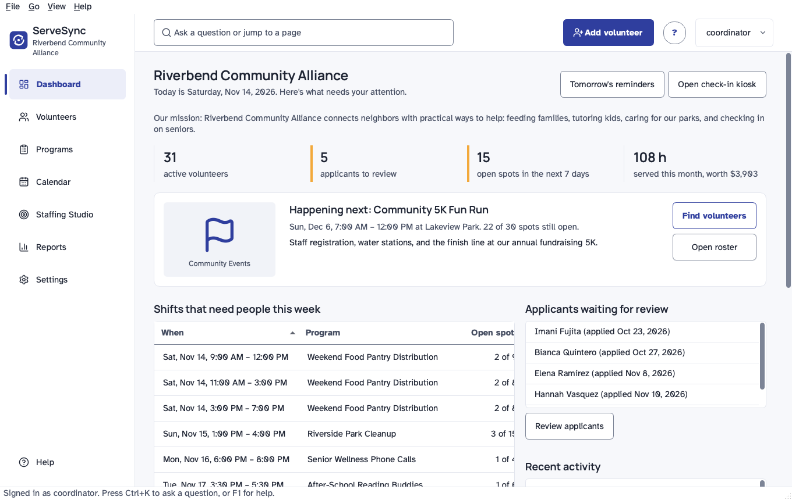

---

## Quick start

Requires **Python 3.10 or newer** (3.12 recommended). Everything runs offline.

**macOS shortcuts:** double-click `setup_mac.command` once (it does steps 1–4 below and saves its
output to `setup_log.txt`), then double-click **`ServeSync.command`** whenever you want to open the app.
Before a practice run or on competition day, double-click `reset_demo.command` (type YES) so the
demo's dates are current. To make a standalone **ServeSync.app** that runs without Python, double-click `build_mac.command`
(it re-runs the tests first, then builds `dist/ServeSync.app`). On any computer,
`ServeSync --check` (or `python main.py --check`) confirms the app is ready without opening a window.

```bash
# 1. Create an isolated environment (keeps the judging laptop clean)
python -m venv .venv
# Windows:  .venv\Scripts\activate
# macOS:    source .venv/bin/activate

# 2. Install dependencies
pip install -r requirements-dev.txt

# 3. Build the demo database
python devtools.py reset --yes

# 4. Verify everything
python -m pytest          # 628 automated tests, including the interface
python devtools.py summary

# 5. Open the app
python main.py
```

On first launch with an empty database, ServeSync asks whether to load the demo organization or
create your own organization's first administrator account.

### Demo sign-ins

All demo accounts use the password **`ServeSync2026!`** (demo data only — change for real use).

| Username        | Role                  | Shows off                                  |
|-----------------|-----------------------|--------------------------------------------|
| `admin`         | Administrator         | Full access, accounts, settings            |
| `coordinator`   | Volunteer Coordinator | Scheduling, attendance, reports            |
| `jordan.rivera` | Volunteer (age 16)    | Minor safeguards and age-restricted shifts |
| `priya.patel`   | Volunteer (adult)     | Self-service portal and service history    |

### Spanish (Español)

Sign in, then choose **Settings → Language / Idioma → Español** (or pick **Español** at the top of
the sign-in screen). Everything switches at once. To see every screen in Spanish without signing
in: `python tools/capture_screens.py screens-es --language es`.

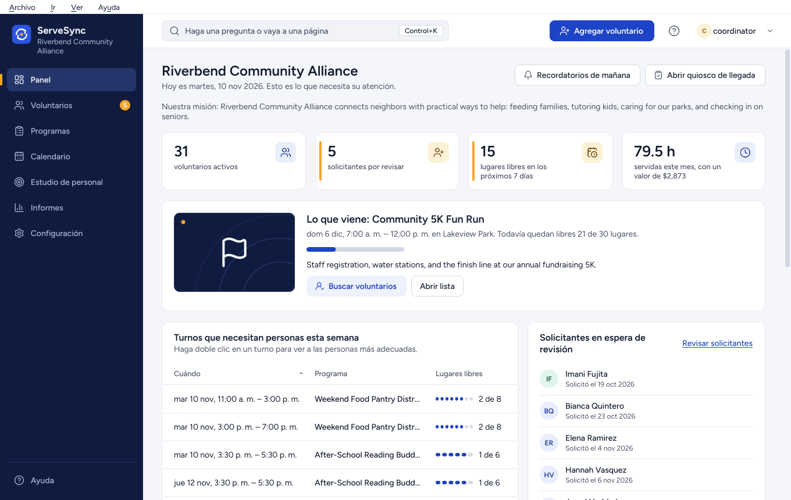

How the translation works, for anyone adding a feature:

* Code is written in English, and every message on screen is wrapped in `tr("...")` (or
  `tr_n(singular, plural, count)` for plurals). The English text is the message ID.
* Spanish lives in `servesync/locale/es.json`. Run `python tools/messages.py` to see whether any
  message is missing a translation, and `python tools/messages.py --missing` to print them ready
  to fill in. The tests fail if a message has no Spanish or a translation drops a `{placeholder}`.
* Dates and times go through `format_day`, `format_clock` and friends in `servesync/core/i18n.py`.

### Developer commands

| Command                           | What it does                                        |
|-----------------------------------|-----------------------------------------------------|
| `python devtools.py init`         | Create or upgrade the database schema               |
| `python devtools.py seed`         | Load the demo organization into an empty database   |
| `python devtools.py reset --yes`  | Erase and reload demo data (run before presenting!) |
| `python devtools.py summary`      | Print record counts, hours, and dollar impact       |
| `python devtools.py smartmatch`   | Demo Smart Match on the shift that most needs people |
| `... smartmatch --volunteer priya.patel` | Shifts Smart Match recommends for one volunteer |
| `--data-dir PATH` (before command)| Use a different data folder                         |

---

## Working together on GitHub

The project is a normal Git repository, so it can be shared with a teammate on GitHub.

**First time (the person who has the code):**

1. Create an **empty** repository on github.com (no README, no .gitignore, no license; we already have them).
2. In a terminal inside the `servesync` folder:
   ```bash
   git remote add origin https://github.com/YOUR-USERNAME/servesync.git
   git push -u origin main
   ```
   Or, with **GitHub Desktop**: *File → Add Local Repository →* choose the `servesync` folder → **Publish repository**.
3. On GitHub, open **Settings → Collaborators** and invite your partner.

**Your partner:**

```bash
git clone https://github.com/YOUR-USERNAME/servesync.git
cd servesync
python -m venv .venv && source .venv/bin/activate   # Windows: .venv\Scripts\activate
pip install -r requirements-dev.txt
python devtools.py reset --yes
python -m pytest && python main.py
```

**Every day:** `git pull` before you start, then `git add -A && git commit -m "What changed"` and
`git push` when you finish a piece. Run `python -m pytest` before pushing. The database, logs and
build output are listed in `.gitignore`, so each person keeps their own demo data.

---

## Why Python (language selection)

ServeSync's requirements are a standalone desktop program that works offline, keeps related records
safe, runs on the Mac or Windows laptop in front of the judges, and has logic complex enough to need
real tests. Python fits each one:

| Need | How Python meets it |
|---|---|
| Native desktop interface, one code base for macOS and Windows | **PySide6**, the official Python binding for **Qt**, a mature cross-platform GUI framework with model/view tables, an accessibility layer, and a signal-and-slot event system |
| Reliable offline storage | **`sqlite3`** is in the standard library: an embedded **relational database** with **ACID transactions**, foreign keys, and `CHECK` constraints, and no server to install |
| Modular, object-oriented design | Classes, **dataclasses**, **enums**, and **dependency injection** keep models, data access, business rules, and screens in separate layers |
| Correctness in a dynamically typed language | Optional **static type hints**, checked by **mypy** in strict mode, plus **pytest** unit and interface tests and the **ruff** linter |
| Fast iteration | A high-level, **interpreted** language with automatic memory management, so effort goes to rules and usability rather than boilerplate |
| Runs without Python installed | **PyInstaller** bundles the interpreter and libraries into a standalone application |

**Trade-offs against the alternatives.** Java with JavaFX is also cross-platform, but needs more
ceremony for the same data classes. C# with WinForms or WPF is strongest on Windows alone. Electron
(JavaScript) ships a whole browser with each app and would still need a database added. A website
would need a server and internet access, which conference Wi-Fi can't promise. Python's main cost is
raw speed, which doesn't matter here: an organization's records are small, and the slow steps are
database queries and password hashing, which run in compiled code.

---

## Architecture

ServeSync uses a **layered architecture**. Each layer depends only on the layers beneath it, so
every piece has one job (Single Responsibility Principle) and can be tested on its own.

```
┌────────────────────────────────────────────────────────────┐
│ ui/        PySide6 screens, dialogs, design system,        │
│            motion, charts, screen-reader announcements     │
├────────────────────────────────────────────────────────────┤
│ services/  Business rules: sign-in, recruitment pipeline,  │
│            scheduling, attendance, Smart Match, reports,   │
│            Ask ServeSync, comfort preferences              │
├────────────────────────────────────────────────────────────┤
│ data/      DataStore facade → Repositories → Database      │
│            (SQL lives only here)                           │
├────────────────────────────────────────────────────────────┤
│ models/    Self-validating domain objects (dataclasses)    │
├────────────────────────────────────────────────────────────┤
│ core/      Errors, validators, password security           │
└────────────────────────────────────────────────────────────┘
```

```
servesync/
├── config.py            Paths (per-user app data), business constants
├── logging_setup.py     Rotating log file — no raw errors ever reach the user
├── core/
│   ├── errors.py        Domain exception hierarchy with user-safe messages
│   ├── validators.py    Syntactic + semantic input validation library
│   ├── security.py      PBKDF2-HMAC-SHA256 password hashing
│   └── i18n.py          English/Spanish: tr(), plurals, language-aware dates and times
├── locale/
│   └── es.json          Spanish translation of every on-screen message
├── models/
│   ├── enums.py         Statuses, roles, categories, day parts, themes
│   ├── volunteer.py     Volunteer + AvailabilitySlot
│   ├── opportunity.py   Opportunity + Shift
│   ├── assignment.py    Sign-up / attendance record
│   ├── account.py       UserAccount (leaders and volunteers)
│   ├── preferences.py   Per-person comfort settings (Appearance), with repair
│   └── read_models.py   Query-shaped views (ShiftOverview, ServiceFact, ...)
└── data/
    ├── database.py      Connection, nested transactions, error translation
    ├── migrations.py    Versioned schema (PRAGMA user_version)
    ├── converters.py    ISO-8601 date/time storage, LIKE escaping
    ├── store.py         DataStore facade (dependency-injection root)
    ├── seed.py          Deterministic, date-relative demo data
    └── repositories/    One repository per aggregate
└── services/
    ├── __init__.py      Services container (composition root)
    ├── session.py       Signed-in Session + role permissions
    ├── clock.py         Injectable clock (real or fixed for tests)
    ├── rules.py         Business rules as pure functions
    ├── auth_service.py          Sign-in, lockout, passwords, accounts
    ├── volunteer_service.py     Profiles + recruitment pipeline
    ├── opportunity_service.py   Programs, shifts, weekly recurrence
    ├── scheduling_service.py    Sign-ups and cancellations
    ├── attendance_service.py    Check-in, no-shows, walk-ins, hours
    ├── matching_service.py      Smart Match recommendation engine (access-aware)
    ├── staffing_service.py      Autopilot, attendance forecast, re-engagement
    ├── settings_service.py      Organization details + per-person comfort settings
    ├── reports/                 model · analytics (pure math) · service · export (CSV, HTML)
    └── assistant/               language (parsing) · knowledge (help search) · service (answers)
└── ui/
    ├── app.py           Start-up, sign-in/sign-out cycle, last-resort error handler
    ├── main_window.py   Sidebar (logo, pages), header (Ask, call to action), shortcuts
    ├── theme.py         Design tokens (3 brand colors), four themes (AAA contrast), 8 px grid, stylesheet
    ├── motion.py        Spring easing; every animation honors Reduce motion
    ├── feedback.py      Screen-reader announcer (live region) and toasts
    ├── report_files.py  Atomic CSV and PDF saving
    ├── assets.py        Bundled fonts and icons (recolored per theme)
    ├── photos.py        Shrinks program photos to under 300 kB
    ├── context.py       Session + event hub shared by every screen
    ├── pages/           Dashboard, Volunteers, Programs, Calendar, Reports, Settings,
    │                    Home, Find a shift, My hours, My profile
    ├── dialogs/         Sign-in, setup, volunteer/program/shift forms, Ask ServeSync,
    │                    shift workspace (roster + Smart Match), help, recent messages
    ├── widgets/         Tables, forms, keyboard-navigable charts, banner, calendar
    └── assets/          Fonts, Lucide icons, logo, license files
tests/                   628 pytest tests (in-memory databases, fixed clock, offscreen UI)
tools/capture_screens.py Renders every screen to PNG (design review, slides; --language es)
tools/messages.py        Lists every on-screen message and any still missing a Spanish translation
tools/make_icon.py       Draws the app icon for the standalone build
servesync.spec           PyInstaller recipe for the standalone app (build_mac.command runs it)
devtools.py              Command-line developer and demo tools
```

### Design patterns used

| Pattern / principle            | Where                         | Why it matters                                   |
|--------------------------------|-------------------------------|--------------------------------------------------|
| Layered architecture           | whole project                 | Change the UI without touching business rules    |
| Repository                     | `data/repositories/`          | All SQL in one tested place                      |
| Facade + dependency injection  | `data/store.py`               | Tests swap in an in-memory database in one line  |
| Self-validating value objects  | `models/`                     | An invalid record can never exist in memory      |
| Command-query separation       | `models/read_models.py`       | Screens get exactly the joined data they need    |
| Schema migrations              | `data/migrations.py`          | Upgrades keep an organization's existing data    |
| Defense in depth               | validators **and** SQL CHECKs | Two independent layers guard every rule          |
| Role-based access control      | `services/session.py`         | Permissions checked in services, not just the UI |
| Pure functions for rules       | `services/rules.py`           | Policies readable in one place, tested instantly |
| Injectable clock               | `services/clock.py`           | Time-based rules tested without waiting          |
| Composition root               | `services/__init__.py`        | One place wires every service together           |
| Model/view                     | `ui/widgets/table.py`         | One sortable, accessible table for every list    |
| Observer (event hub)           | `ui/context.py`               | Every screen refreshes after any change          |
| Pure analytics                 | `services/reports/analytics.py` | Every report figure is unit-tested math        |
| Design tokens                  | `ui/theme.py`                 | One change restyles every screen; contrast tested; no hex values in screens |

---

## User experience design

| Screen | |
|---|---|
| 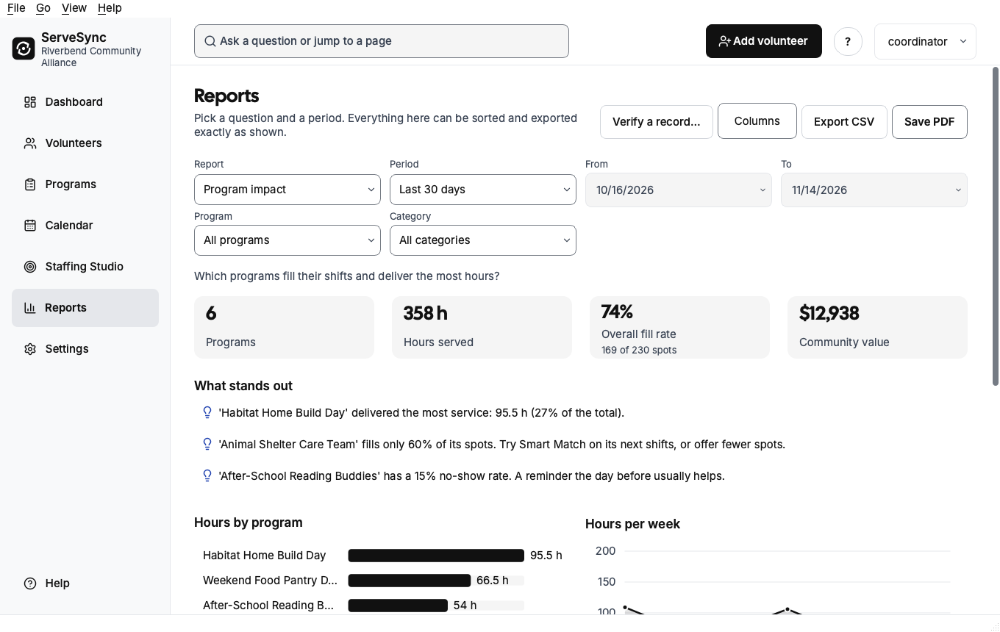 | 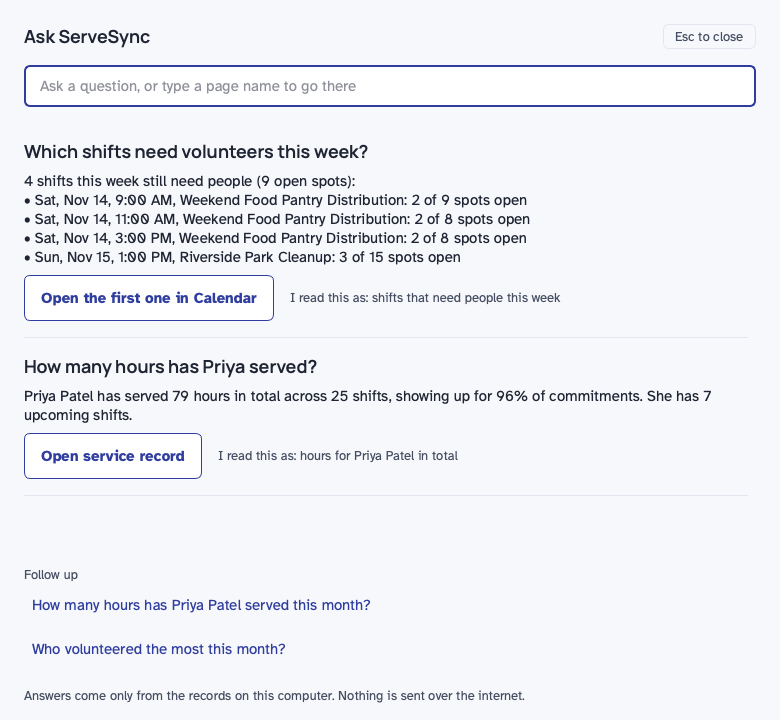 |
| 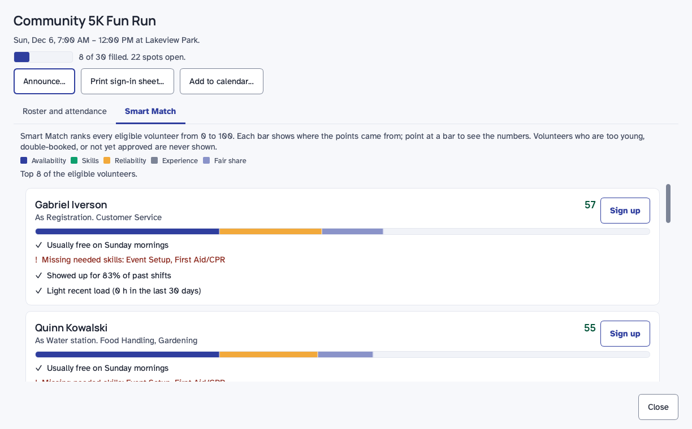 | 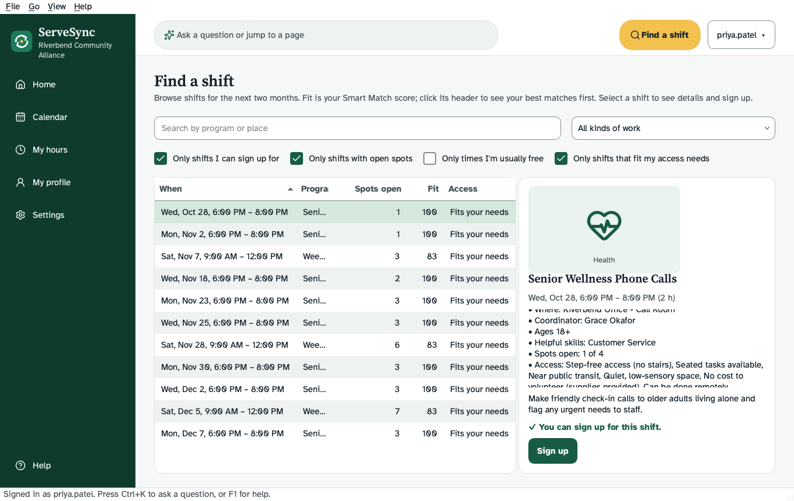 |
| 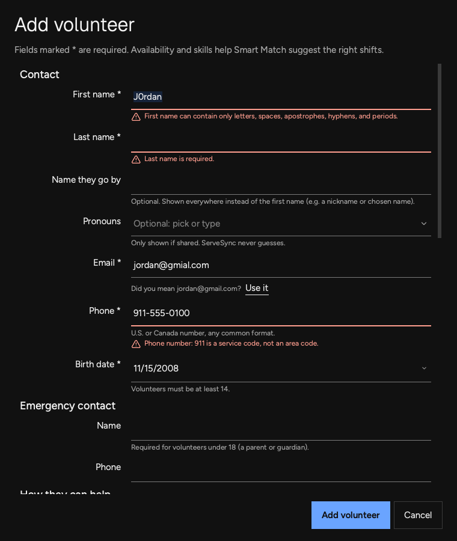 | 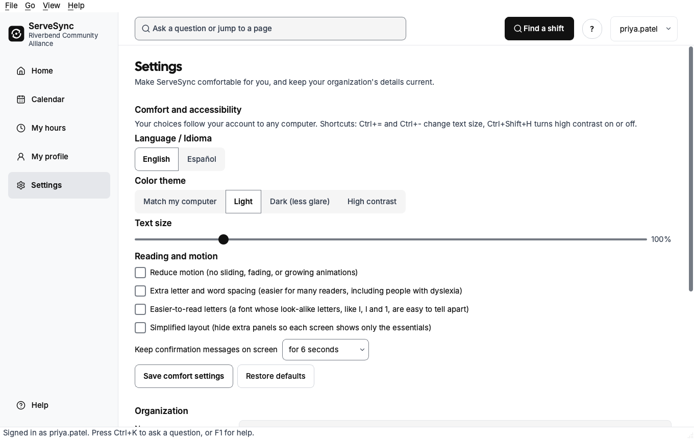 |

### Six principles of great nonprofit design, applied

| Principle | How ServeSync applies it |
|---|---|
| **1. A strong design system** | A dark, editorial look modelled on the Hyperiux Vault sign-in page, recolored in blue: near-black canvas, large light headings with one word in blue, monospaced labels, underline fields, square corners and hairlines. One blue does all the pointing; amber and green are only markers. Every color is defined once as a token and checked for 7:1 text contrast in Dark (default), Light and High contrast. Geist for titles, Figtree for text, IBM Plex Mono for labels, and Atkinson Hyperlegible as the *Easier-to-read letters* setting. One icon set (Lucide), with each idea keeping the same icon everywhere |
| **2. Visually pleasing, functional choices** | A calm, flat layout on an 8 px grid: sections separated by space and hairlines, cards only for separate objects, one filled button per screen; readable fonts; click targets at least 44 px tall; Gestalt grouping |
| **3. Regularly updated content** | A dynamic *Happening next* banner (one featured event, never a carousel), a live activity feed, a shift calendar, and impact figures that update as hours are recorded |
| **4. Images and video that build empathy** | Each program can show the organization's own photo, automatically resized under 300 kB; story-video links open only when someone chooses to watch (never autoplay); original category artwork when no photo is added |
| **5. Familiar layout conventions** | Logo top-left, pages in a sidebar that keeps your place visible, one visually distinct call-to-action button in the upper-right (*Add volunteer* for leaders, *Find a shift* for volunteers); the home page leads with the mission statement, impact statistics, and a call to action; a calm callout panel sits at the bottom — no pop-up asks |
| **6. Easy to scan** | Concise home pages; headings, bullet points, and short sentences; deeper detail on inner pages; master-detail layouts keep your place |

The full reasoning behind the colors, type, layout and accessibility choices is in
[docs/design-rationale.md](docs/design-rationale.md).

### User journeys

* **Coordinator, Monday morning:** Dashboard → "5 applicants to review" → Volunteers (already
  filtered) → Approve → back to the dashboard's *Shifts that need people* → open a shift →
  Smart Match → Sign up the top match.
* **Volunteer, finding a shift:** Home → *Recommended for you* → Sign up; or *Find a shift* →
  "Only shifts I can sign up for" → sort by Fit → Sign up. If a shift is unavailable, the reason
  is shown in plain words (too young, already booked, full).

### Accessibility (WCAG 2.2, AAA where it applies to a desktop app)

WCAG is written for web pages; for desktop software, W3C's WCAG2ICT guidance maps each
criterion to native apps. ServeSync targets **AA everywhere and AAA wherever it applies**, and
the color claims are checked by `tests/test_theme.py`, which computes the contrast ratios.

| Need | What ServeSync does | WCAG |
|---|---|---|
| Low vision | Text at 7:1 contrast or better in every theme; High contrast theme; text 85–200% (Ctrl+= / Ctrl+-); nothing clips | 1.4.6 AAA, 1.4.4 |
| Finding controls | Input borders, checkboxes, and focus rings at 3:1 or better; 2–3 px focus outline on everything | 1.4.11, 2.4.13 AAA |
| Motor / tremor | Every target at least 44 × 44 px, growing with text size | 2.5.5 AAA |
| Keyboard only | Every action works without a mouse; charts are navigable with arrow keys; Ctrl+K reaches any page or answer | 2.1.3 AAA |
| Screen readers | Accessible names on every control; changes announced through the platform screen reader without moving focus (polite vs. urgent, merged, never repeated); charts have text summaries and a matching table | 4.1.3, 1.1.1 |
| Vestibular / motion sensitivity | Motion only answers your action; *Reduce motion* removes it entirely | 2.3.3 AAA |
| Dyslexia | *Easier-to-read letters* (Atkinson Hyperlegible) and optional extra letter and word spacing | 1.4.12, 1.4.8 AAA |
| Attention / cognitive load | *Simplified layout* hides secondary panels; plain-language messages; one call to action per screen | 3.1.5 AAA |
| Reading speed | Messages stay 6 s, 20 s, or until closed; pause while hovered; *Recent messages* keeps the last 30 | 2.2.1, 2.2.3 AAA |
| Color vision | Status always has words or a shape; chart values printed on every bar | 1.4.1 |
| Preference everywhere | Comfort settings follow the person's account; Dark is the default, and *Match my computer* follows the OS light or dark mode, live | — |

### Inclusion beyond the screen

* **Names and pronouns.** An optional *name they go by* is shown everywhere (the legal name
  appears only on safety records and service-hour records); pronouns are shown only if shared,
  and the assistant uses them ("She has 8 upcoming shifts") — otherwise it uses the person's name.
* **Access needs, never a barrier.** Volunteers may share needs (step-free access, seated tasks,
  near public transit, a quiet space, no out-of-pocket cost, remote); programs list what they
  offer. Smart Match ranks people whose needs a program doesn't list *after* everyone else, with
  the reason shown — nobody is ever hidden or refused. *Find a shift* shows fitting shifts first,
  with one click to see everything.
* **Socioeconomic access.** *No cost* and *near public transit* are first-class filters; volunteers
  without a car or spare money see programs that work for them. Students get a signed
  **service-hours record** PDF for school, scholarships, and job applications.
* **Shared computers.** Each person's settings load at sign-in, so a front-desk laptop works for
  everyone.
* **English and Spanish.** About 42 million people in the U.S. speak Spanish at home, and many
  volunteers and families read it more comfortably. Every screen, message, report, PDF/CSV export,
  help page, date ("sáb 7 nov, 9:00 a. m.") and *Ask ServeSync* answer is available in Spanish.
  Choose **English | Español** on the sign-in screen or in *Settings*; the choice is saved per
  account, switches instantly, and the switch is labeled in both languages so anyone can find it.
  Names, program titles and other records people type stay exactly as entered.

### Reports (customizable output and analysis)

Pick a question (*Volunteer hours, Program impact, Shift attendance, Recruitment channels and referrals, Impact summary,
Certification expiry,* or one
person's *Service hours record*), then a period (presets including *This school year*, or custom
dates), and optionally a program or category. Each report shows four headline figures,
**plain-English insights** (for example, which weekday fills best and which fills least,
how much of the service the top fifth of volunteers gave, and which shifts have already started but
still have attendance to record), a bar
chart, a trend line, and a sortable table. **Columns** chooses what to show; **Export CSV** and
**Save PDF** contain exactly what you see. All five leader reports reconcile to the same total
hours — a test proves it.

### Ask ServeSync (interactive Q&A)

Press **Ctrl+K** and ask in plain English: *Who is free Saturday morning? How is the food pantry
doing? Which shifts need volunteers this week? How many hours has Priya served? How do I export a
report?* It works **fully offline** (conference Wi-Fi is unreliable, and volunteer data should stay
on the computer): questions are normalized and stemmed, dates ("this month", "in October"),
times ("weekday evenings"), people (typo-tolerant: "Pryia" → Priya) and programs are extracted,
and the intent is scored from weighted cue words. Every answer comes from live records, says what
it understood, offers a button to the right page, and suggests follow-ups. Volunteers can only ask
about themselves. Typing a page name instead jumps straight there. It understands **Spanish** too —
*¿Quién está libre el sábado por la mañana?*, *¿Cuántas horas tengo este mes?*, *¿Cómo exporto un
informe?* — with or without accents, and answers in the interface language.

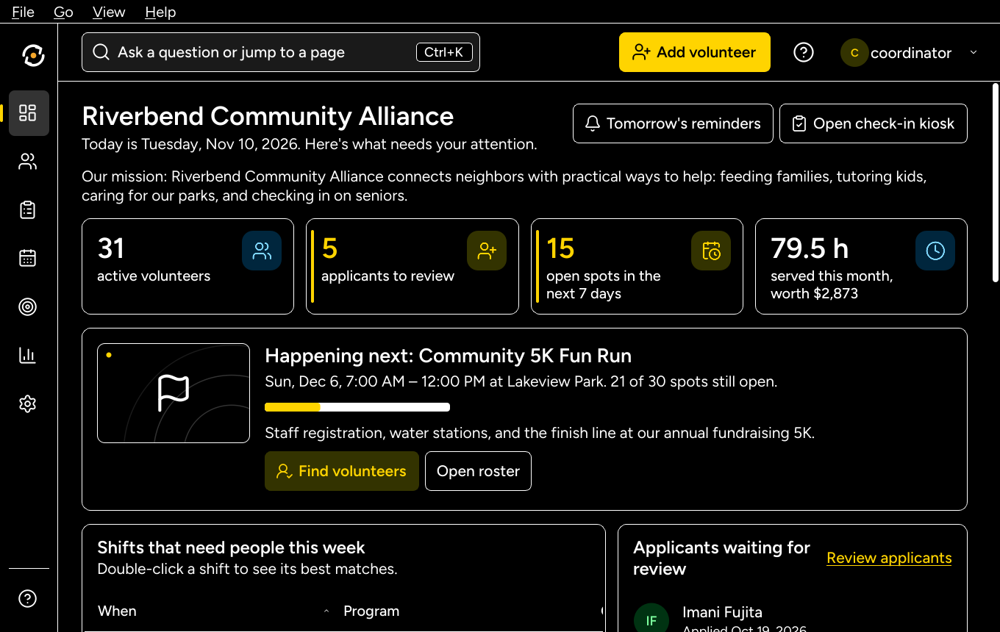

---

## Data model

```
volunteers ─┬─< volunteer_skills >── skills ──< opportunity_skills >─┬─ opportunities
            ├─< volunteer_availability                               │
            ├── user_accounts (VOLUNTEER role)                       │
            └─< assignments >── shifts >─────────────────────────────┘
```

| Table                    | Purpose                                                        |
|--------------------------|----------------------------------------------------------------|
| `volunteers`             | People, contact info, recruitment status and source            |
| `skills`                 | Shared skill catalogue (case-insensitive, no duplicates)       |
| `volunteer_skills`       | Skills each volunteer has (many-to-many)                       |
| `volunteer_availability` | Weekly availability: weekday × morning/afternoon/evening       |
| `opportunities`          | Programs and events, category, minimum age, status             |
| `opportunity_skills`     | Skills each opportunity needs                                  |
| `shifts`                 | Dated time blocks with a volunteer capacity                    |
| `assignments`            | Sign-ups and attendance outcomes, hours served                 |
| `user_accounts`          | Sign-in identities and roles (hashed passwords only)           |
| `opportunities.story_video_url` | Optional story video link (added in schema version 2)   |
| `volunteers.referred_by`, `hour_goal`, `hour_goal_due` | Who invited a volunteer; their personal goal (schema version 4) |
| `opportunities.impact_unit`, `shifts.impact_amount` | What a program measures; what a shift achieved (schema version 5) |
| `volunteer_certifications`, `opportunity_certifications` | Certifications held, with expiry dates; certifications a program requires (schema version 5) |
| `shift_roles`, `assignments.role_id` | Roles within a shift, each with a capacity and optional skill; the role each sign-up fills (schema version 6). A trigger rejects a role from another shift |
| `waitlist`, `notices` | People waiting for a full shift, oldest first; Home-page notices stored as *what happened*, worded in the reader's language when shown (schema version 6) |
| `volunteer_certifications.kind`, `issued_on` | Certification or waiver, and its issue date (schema version 6) |
| `change_log`, `deletion_requests` | Who changed what and when (codes, not values); volunteers' requests to remove their details, one open request each (schema version 9) |
| `issued_documents` | Every service record and certificate saved as a PDF, by its verification code (schema version 8) |
| `announcements` | A leader's note to one program or one shift (exactly one, enforced by a `CHECK`) (schema version 7) |
| `assignments.checked_in_at`, `checked_out_at` | Kiosk arrival and departure; check-out can't come before check-in (schema version 7) |
| `app_settings`           | Organization name, mission statement, value of a volunteer hour, accessibility |
| `volunteer_participation`| *View:* hours, attendance, no-shows, reliability per volunteer |
| `shift_fill`             | *View:* spots filled per shift                                 |

**Records are never silently lost.** Volunteers, shifts, and opportunities that have sign-up
history cannot be deleted (`ON DELETE RESTRICT`); leaders archive them instead (Inactive / Closed),
so hour totals and reports stay accurate.

---

## Input validation

Every input passes two levels of checks before it can be saved:

| Level         | Question it answers          | Examples                                                                 |
|---------------|------------------------------|--------------------------------------------------------------------------|
| **Syntactic** | Is it shaped correctly?      | Email format, phone digits, `MM/DD/YYYY` dates, whole numbers            |
| **Semantic**  | Does it make sense?          | Birth date not in future; 911 is not an area code; Feb 30 doesn't exist; shift ends after it starts and is ≤ 12 h; minors need a guardian contact; opportunity minimum age can't go below the organization's |

Forms receive **every** problem at once (field → message), so users fix everything in one pass.
The database repeats the critical rules as `CHECK`, `UNIQUE`, and foreign-key constraints.

---

## Business rules (service layer)

| Area         | Rules enforced                                                                          |
|--------------|-----------------------------------------------------------------------------------------|
| Sign-in      | Generic error message; equal timing for unknown users; 5 failures → 15-minute lockout; passwords re-hashed automatically if the cost is raised |
| Roles        | Administrator: everything. Coordinator: volunteers, programs, scheduling, attendance, reports. Volunteer: only their own profile, sign-ups, and hours |
| Pipeline     | Applicant → Active or Inactive; Active ↔ Inactive. Archiving cancels upcoming sign-ups (history kept) |
| Programs     | Draft → Open → Closed (and back to Open). Never back to Draft. Closing cancels upcoming sign-ups |
| Shifts       | Start in the future; frozen once started; capacity ≥ current sign-ups; rescheduling re-checks clashes and ages; weekly recurrence up to 52 weeks |
| Sign-ups     | Volunteer must be Active, old enough on the shift date, and not double-booked; program Open; shift not started or full; an open role must fit their skills; required certifications and waivers must be current on the shift date. Checked under a write lock so the last spot can't be taken twice |
| Roles        | A shift's capacity is always the total of its roles. One to twelve roles, unique names; a role can't shrink below or lose the people in it; a role's skill is required, not just preferred. With several roles, the shift is resized by resizing its roles |
| Waitlist     | Only for a full shift, and only for someone kept out by space alone. When a spot frees up (cancellation, archiving, more room), the longest-waiting person who still qualifies is signed up automatically and gets a Home notice; anyone who no longer qualifies keeps their place. Nobody moves up once the shift starts |
| Attendance   | Only after the shift starts; hours default to and never exceed the shift length; walk-ins allowed (age and clash rules still apply) |

### Smart Match (intelligent feature)

Ranks eligible volunteers for a shift — or open shifts for a volunteer — from 0 to 100, and
explains every score in plain English.

| Factor             | Points | Earned by                                                       |
|--------------------|--------|-----------------------------------------------------------------|
| Availability fit   | 30     | Volunteer listed that weekday and time of day                   |
| Skill fit          | 30     | Share of the program's needed skills the volunteer has          |
| Reliability        | 20     | Attended ÷ (attended + no-shows); newcomers get a neutral 70%   |
| Program experience | 10     | Has served this program before (3+ times = full points)         |
| Fair share         | 10     | Light recent load — spreads opportunities and prevents burnout  |

Hard rules (age, status, double-booking, capacity) are filtered out *before* scoring, using the same
rule the sign-up screen uses. "Recommended for you" shows at most two shifts per program for variety.

### Recruiting, check-in, goals, results, and certifications

| Feature | What it does | Rules worth explaining |
|---|---|---|
| **Become a volunteer** | A public form on the sign-in screen, including *Who invited you?* | It can only create an Applicant, whatever is submitted. Anyone under 18 must give a parent or guardian as their contact. If someone seems to be on file already, the answer never says who |
| **Referrals** | The Recruitment report adds *Referred* and *Top referrer* columns for each channel, a headline count, and a chart of who brings in the most volunteers | Names are typed freely, so "Priya Patel" and "priya  patel" count as one person (case and extra spaces are ignored) |
| **Check-in kiosk** | *Dashboard > Open check-in kiosk* turns a laptop into a full-screen welcome desk: find your name, tap to check in, tap again to check out | Opens 30 minutes before a shift and closes when it ends. Large touch targets, both languages. Shows only a first name and last initial. Hours come from the two times: only time inside the shift counts, rounded to the nearest quarter hour, at least a quarter hour. Only the leader's password closes it |
| **Announcements** | *Announce* on a shift or a program | Everyone signed up for it sees the note on Home (1 to 500 characters; only open programs; not after the shift ends). ServeSync never sends messages itself |
| **Tomorrow's reminders** | *Dashboard > Tomorrow's reminders*: everyone on the next day's shifts with phone, email, program, role and time | Any day can be chosen. *Export CSV* is protected against spreadsheet formula injection |
| **Add to calendar** | Saves any shift as a standard `.ics` file (RFC 5545) for Apple, Google or Outlook calendars | Text is escaped and long lines folded at 75 bytes, as the standard requires; times are local to where the shift happens |
| **Paper sign-in sheet** | *Print sign-in sheet* saves a PDF with each person's name, role and phone, columns for time in, time out and signature, and empty rows for walk-ins | The fallback for a day without the laptop |
| **Hour goals** | A volunteer sets hours and a date on *Home*, then sees a progress bar, the weekly pace needed, and a projected finish date. The kiosk reports progress too | Counts from August 1. The projection uses the pace so far (hours per day since August 1); with no hours yet, it says so instead of guessing. The date must be after today. Only that person or a leader can change it. A finished goal turns green |
| **Milestone certificates** | At 25, 50 and 100 hours, *My hours* offers a one-page certificate PDF | Dated by the shift that crossed the milestone. Only reached milestones can be printed |
| **Verification codes** | Every service-hours PDF and certificate carries a code such as `K7Q2-9XFM`; leaders type it into *Reports > Verify a record* | Codes are random (not derived from the data), 8 characters from an alphabet without 0/O/1/I/L, stored with what the document said. Verification shows the person, the hours as issued, and whether that period has since been corrected. Try the demo codes **RVBD-7K2M** (Priya's service record) and **HQ5M-TZPA** (her 50-hour certificate) |
| **Results and impact summary** | A program names what it measures (*families served*); leaders enter the number on the roster when recording attendance; the *Program impact* report shows each program's result, and the *Impact summary* report saves as a one-page PDF for any date range, with *Sections* to choose what it includes | A result can only be recorded after the shift starts. Missing results are reported, never guessed |
| **Certifications and waivers** | A program can require a certification or a signed waiver; leaders record each person's type, issue date and expiry date | A hard rule inside the one shared `signup_blockers` check, so manual sign-up, Smart Match, and Autopilot all enforce it; walk-ins and the kiosk check it too. It must still be valid on the day of the shift. The issue date can't be in the future or after the expiry. Volunteers can't certify themselves. The Dashboard lists what runs out in 30 days; the *Certification expiry* report covers what has expired or runs out within 90 days |
| **Roles within a shift** | *Edit roles* splits a shift into jobs (Registration x4, Water station x12, First aid x2 needing First Aid/CPR) | Volunteers pick a role when they sign up; ServeSync suggests the one that uses their skills. Smart Match and Autopilot place people by skill and never overfill a role. The roster is grouped by role |
| **Waitlist** | *Join waitlist* on a full shift | The next person who qualifies is signed up when a spot opens, and finds a note on Home. Leaders see who is waiting on the roster |

Every result in the demo is sample data calculated from attendance.

### Help built in

| Feature | What it does |
|---|---|
| **How ServeSync addresses the topic** | *Help > How ServeSync addresses the topic* maps each phrase of the FBLA prompt (recruit, organize, manage, coordinate, manage service opportunities, maintain records, monitor participation, the needs of volunteers and of leaders) to the screens that do it |
| **First-run tour** | A short tour for each role (leaders: 8 steps; volunteers: 6) on first sign-in. It's a card in the corner, not a pop-up: the page stays usable, the control it describes is outlined, each step is read aloud by screen readers, and *Skip tour* (or Esc) ends it. *Help > Take the tour* replays it |
| **The ? button** | In the header on every page: what this page is for, in a few lines, with a link to all help topics |
| **Ask ServeSync** | Help articles for every feature, in English and Spanish, found by plain questions (Ctrl+K) |

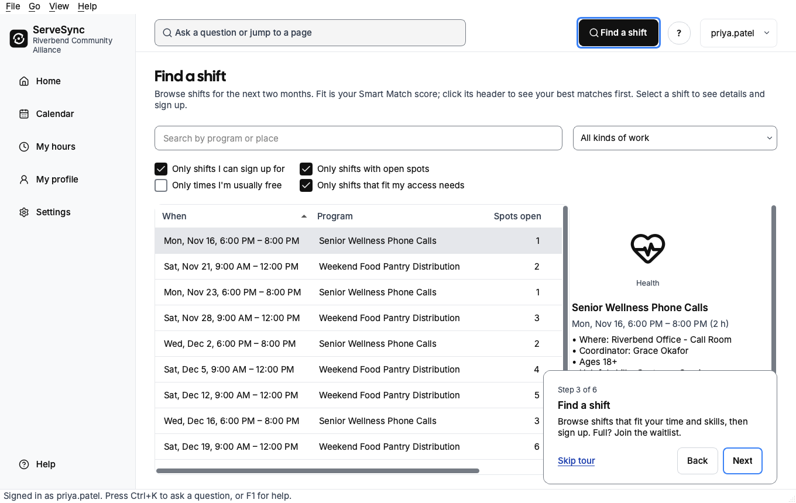

### Data and trust

| Feature | What it does | Rules worth explaining |
|---|---|---|
| **Import from CSV** | *Volunteers > Import* reads a spreadsheet saved as CSV and previews every row with exactly what to fix (line number and field) | Each row passes the same checks as the volunteer form, plus: no two rows share an email, and nobody already on file is added twice. Nothing is saved until every row is ready; then all rows are saved in one transaction. English or Spanish headings, extra columns skipped (and listed), UTF-8 or Excel's Windows encoding. *Save template* gives the headings |
| **Backup and Restore** | *Settings > Back up* writes one `.zip` with a consistent snapshot of the database (SQLite's online backup), every program photo, and a manifest | *Restore* checks the file first: a ServeSync backup, intact (`PRAGMA integrity_check`), not from a newer version, with the core tables and an active administrator. Older backups are upgraded by the normal migrations. Everyone is signed out afterward |
| **Change history** | *Settings > Change history* (administrators): who changed what, and when, searchable by name or user and filterable by kind of record | Stored as codes (action, record type, field names), so it reads in either language. It names changed fields but never copies their values, so it isn't a second copy of personal data |
| **Privacy** | Volunteers: *My profile > Download my data* (a readable JSON file of everything held about them) and *Request deletion*. Administrators complete or decline requests in *Settings* | Someone with no service history is deleted outright. For anyone else, every personal detail is removed (name, contact, birthday reduced to the year, skills, availability, certifications, sign-in, and their name in the change history) but the hours stay, so totals still add up. One open request per person (a database index) |

### Staffing Studio (look ahead, then act)

Smart Match answers "who is best for this shift?" Staffing Studio answers the coordinator's bigger
questions, on one leaders-only page, over the next two weeks.

| Tool | Question | How it works |
|---|---|---|
| **Autopilot** | How do I staff everything at once? | Shares people *across* shifts with a greedy heuristic: the shift with the least slack (strong candidates minus open spots) chooses first. It only drafts people who score 60 or more, are usually free, and have no access gap; drafts at most 2 shifts per person, never overlapping; and takes 2 score points per hour already planned, so work is spread fairly |
| **Attendance forecast** | Which shifts may come up short, even if they look full? | Expected turnout is the sum of each signed-up person's show-up rate (newcomers count as 70%). At least 75% of capacity is *On track*, at least 50% is *Watch*, and less is *At risk*. Always shown in words as well as color |
| **Worth a personal invitation** | Who has quietly stopped coming? | Active volunteers with service history, nothing upcoming, and 45+ days away, most hours first, each with the shift Smart Match rates best for them |

A person stays in charge. Autopilot saves nothing until the coordinator approves; each line says who,
where, and why; any line can be unticked; every sign-up still passes the normal rules; and *Undo last
approval* reverses the batch. If something changed since the draft, that one sign-up is skipped and
explained. ServeSync doesn't send messages, so the coordinator tells each person. The forecast and
thresholds are transparent rules of thumb based on past attendance, not a trained statistical model.

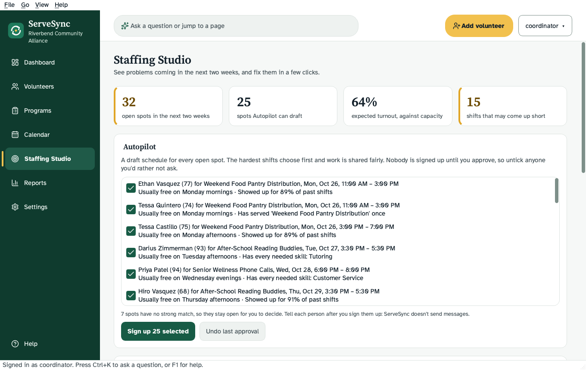

| | |
|---|---|
| 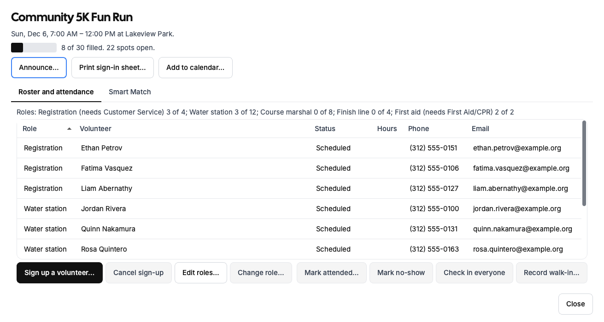 | 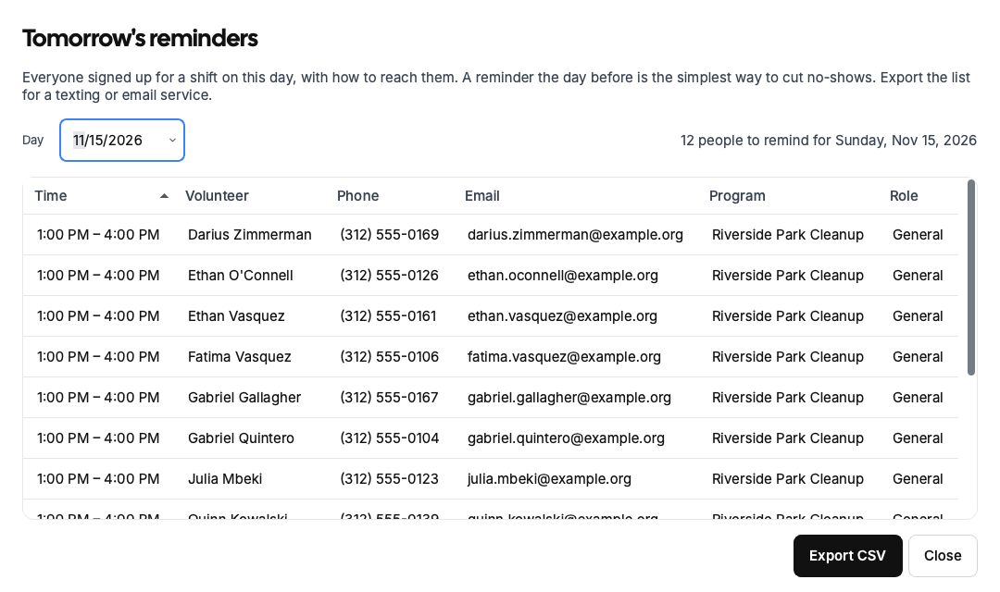 |
| 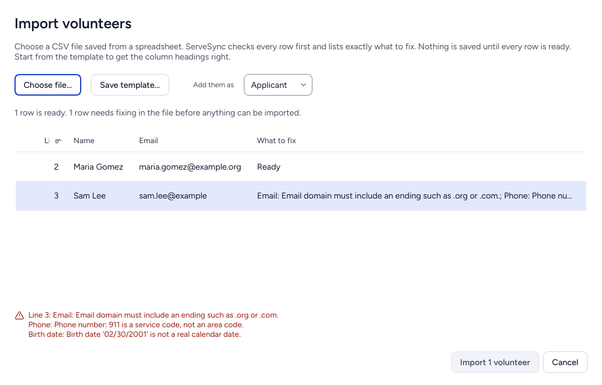 | 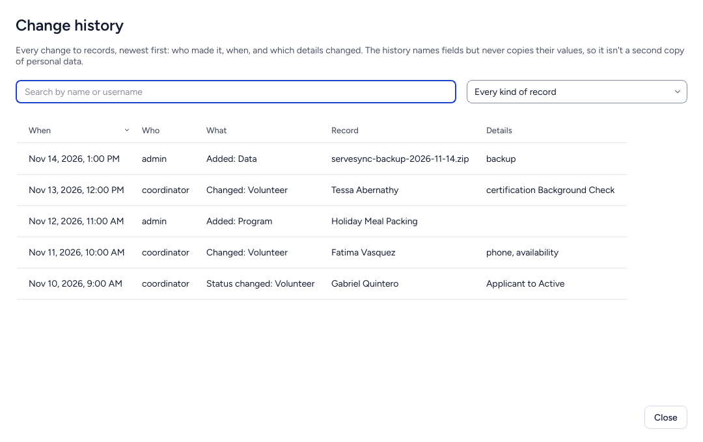 |
| 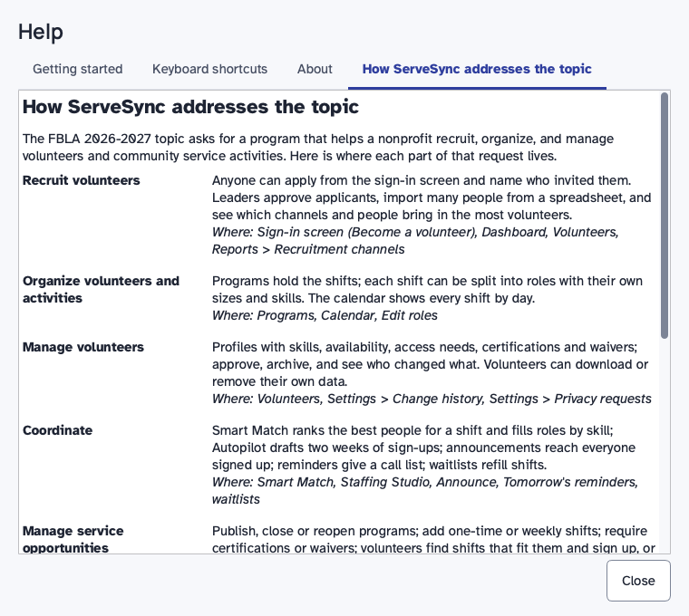 | 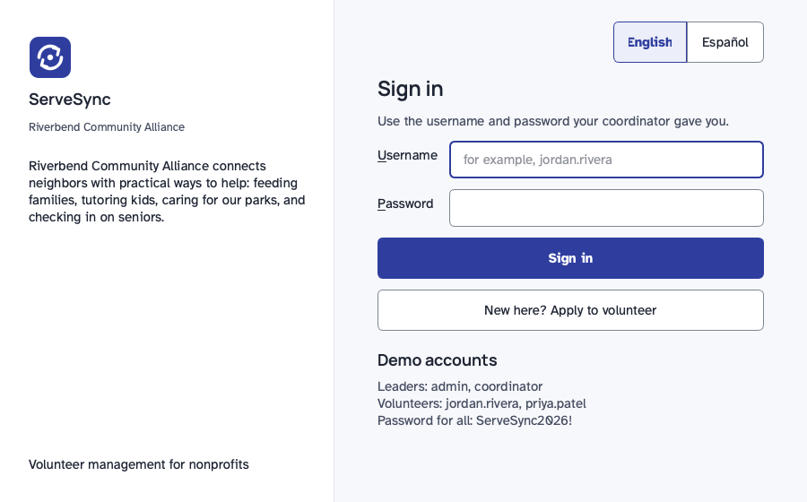 |

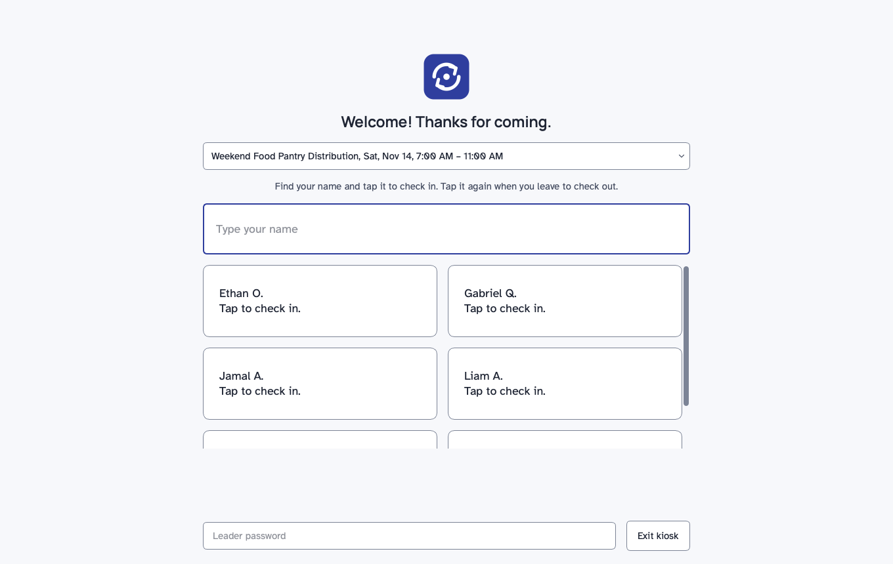

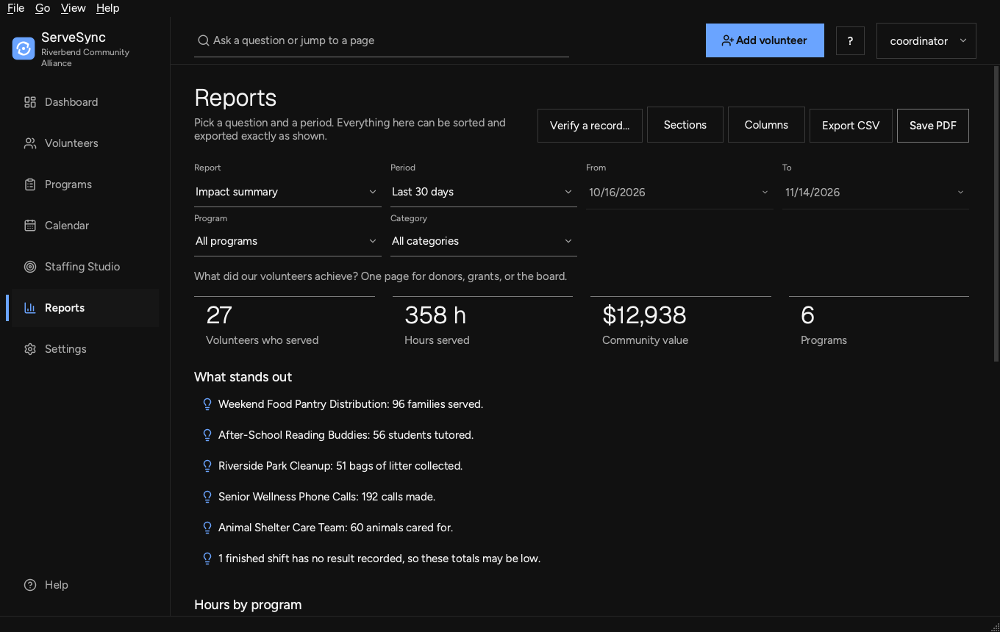

---

## Quality checks

| Check                    | Result                                     |
|--------------------------|--------------------------------------------|
| `python -m pytest`       | 628 tests pass (business logic in seconds; interface tests drive real windows) |
| Test coverage            | 88% of the whole code base, interface included |
| `ruff check .`           | No lint issues                             |
| `mypy` (strict mode)     | No type errors in all 109 files, interface and tests included |
| Contrast                 | Every text color ≥ 7:1, every boundary ≥ 3:1, in all themes (`tests/test_theme.py`) |
| Standalone build         | `ServeSync --check` passes on the built app with no Python installed |

Run them all: `python -m pytest && ruff check . && mypy`

---

## Where data is stored

ServeSync never writes next to its own program files (which can be read-only once installed).

| System  | Location                                    |
|---------|---------------------------------------------|
| Windows | `%APPDATA%\ServeSync\servesync.db`          |
| macOS   | `~/Library/Application Support/ServeSync/`  |
| Linux   | `~/.local/share/ServeSync/`                 |

Override with the `SERVESYNC_DATA_DIR` environment variable or `--data-dir`. Logs are in the
`logs` subfolder and program photos in the `photos` subfolder.

---

## Third-party software and licenses

| Component                 | Use                          | License                                   |
|---------------------------|------------------------------|-------------------------------------------|
| Python 3 standard library | Language runtime, `sqlite3`, `hashlib` | Python Software Foundation License |
| SQLite                    | Embedded database engine     | Public domain                             |
| PySide6 (Qt for Python)   | Desktop user interface       | LGPL v3 (used unmodified, as a library)   |
| Atkinson Hyperlegible     | *Easier-to-read letters* font (Braille Institute) | SIL Open Font License 1.1 (`ui/assets/licenses`) |
| Figtree                   | Interface font (The Figtree Project Authors) | SIL Open Font License 1.1 (`ui/assets/licenses`) |
| Geist                     | Heading font (The Geist Project Authors) | SIL Open Font License 1.1 (`ui/assets/licenses`) |
| IBM Plex Mono             | Label font (IBM Corp.) | SIL Open Font License 1.1 (`ui/assets/licenses`) |
| Lucide icons              | Icon set                     | ISC License (`ui/assets/licenses`)        |
| pytest-qt                 | Interface tests (development only) | MIT                                 |
| PyInstaller               | Builds the standalone app (development only) | GPL v2 with bootloader exception — the built app may be distributed under any license |
| pytest, ruff, mypy        | Testing and code quality (development only)  | MIT                       |

The visual style is modelled on the Hyperiux Vault sign-in page (recolored in blue; no Hyperiux logo, wording, fonts or artwork are used), and the interface was reviewed against the Vercel Web Interface Guidelines. No code was copied from other projects. The ServeSync logo and all category artwork are original.
No copyrighted images or trademarks are used; program photos are added by each organization.

## Sources

- Independent Sector & Do Good Institute (University of Maryland), *Value of Volunteer Time*,
  released April 21, 2026: national value of $36.14 per volunteer hour (2025 wage data).
  https://independentsector.org/research/value-of-volunteer-time/
- OWASP, *Password Storage Cheat Sheet* (PBKDF2-HMAC-SHA256 at 600,000 iterations).
  https://cheatsheetseries.owasp.org/cheatsheets/Password_Storage_Cheat_Sheet.html
- North American Numbering Plan Administrator — area code and N11 service code rules.
  https://www.nanpa.com/
- W3C, *Web Content Accessibility Guidelines (WCAG) 2.2* and *WCAG2ICT* (applying WCAG to
  non-web software). https://www.w3.org/TR/WCAG22/ and https://www.w3.org/TR/wcag2ict-22/
- OWASP, *CSV Injection* — why exported text cells starting with `=`, `+`, `-`, `@` are escaped.
  https://owasp.org/www-community/attacks/CSV_Injection
- IETF RFC 2606 — `example.org` is reserved for documentation, used for all demo emails.
  Demo phone numbers use the 555-0100 to 555-0199 range reserved for fictional use.

All people, organizations, and addresses in the demo data are fictional.
