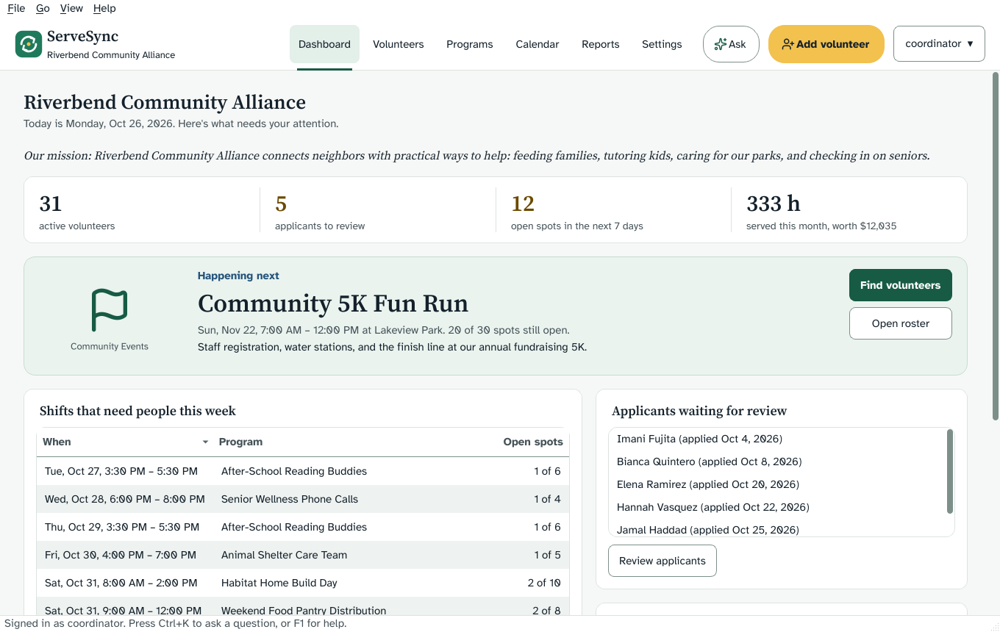
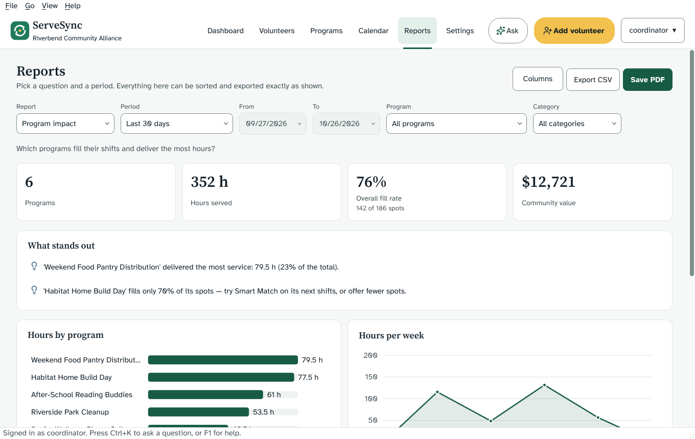
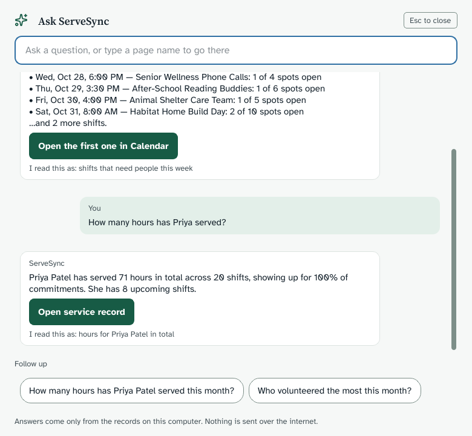
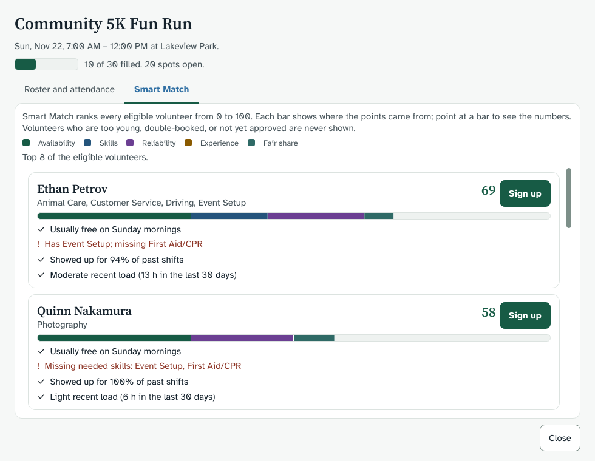
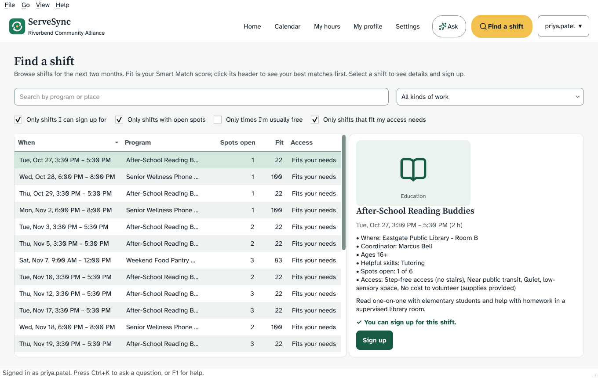
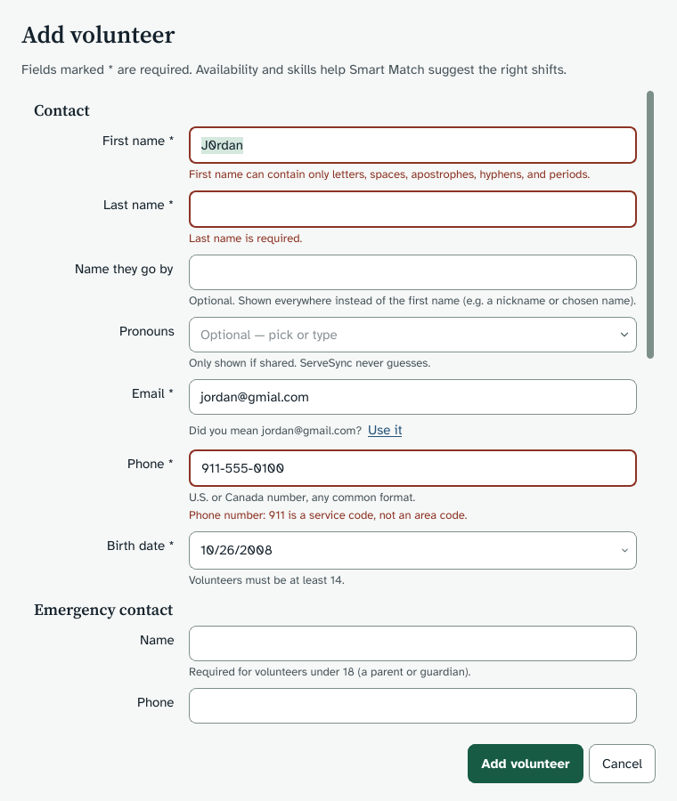
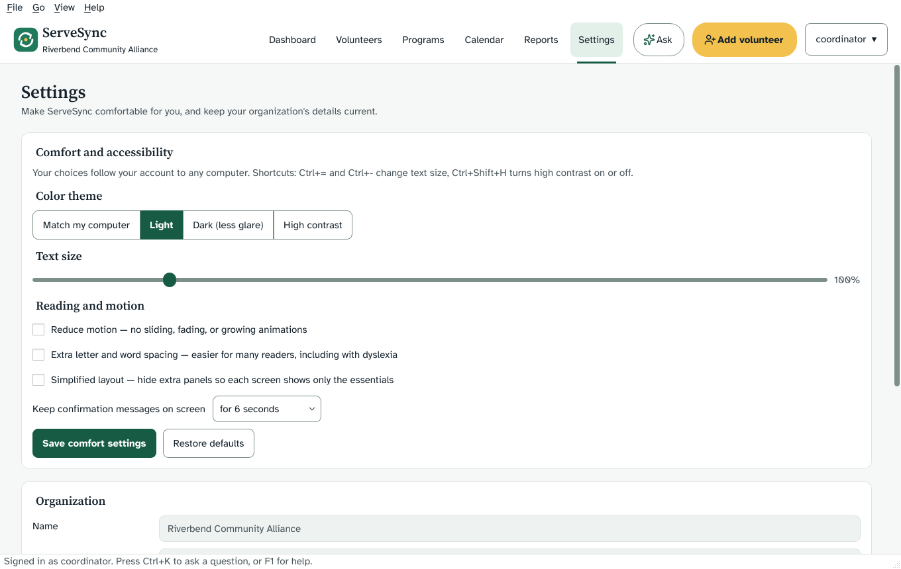
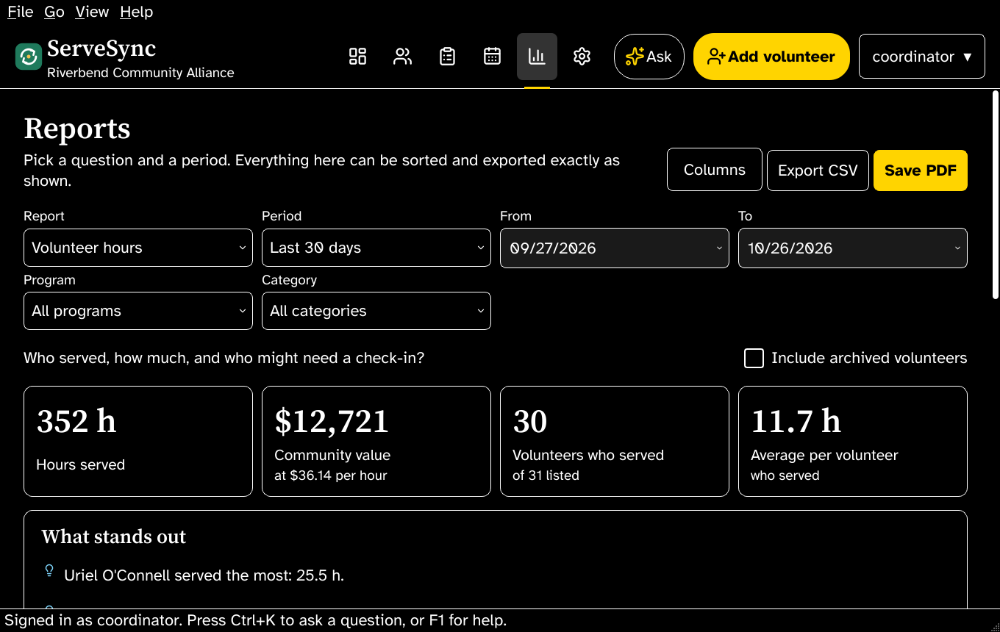

# ServeSync — Volunteer Management for Nonprofits

**FBLA Coding & Programming 2026–2027 · Topic: "Serving the Community: Nonprofit Volunteer Management"**

ServeSync is a standalone desktop application that helps a nonprofit **recruit, organize, and
manage volunteers and community service activities**. Leaders track the recruitment pipeline,
publish service opportunities, schedule shifts, take attendance, and report on participation and
impact. Volunteers sign in to a self-service portal to find shifts, sign up, and see their hours.

> **Build status:** feature-complete and tested — data storage, business rules with Smart Match,
> the desktop interface, customizable reports with CSV/PDF export, the offline *Ask ServeSync*
> assistant, inclusive profiles and comfort settings, and a standalone app build.



---

## Quick start

Requires **Python 3.10 or newer** (3.12 recommended). Everything runs offline.

**macOS shortcuts:** double-click `setup_mac.command` once (it does steps 1–4 below and saves its
output to `setup_log.txt`), then double-click **`ServeSync.command`** whenever you want to open the app.
Before a practice run or on competition day, double-click `reset_demo.command` (type YES) so the
demo's dates are current. To make a standalone **ServeSync.app** that runs without Python, double-click `build_mac.command`
(it re-runs the tests first, then builds `dist/ServeSync.app`). On any computer,
`ServeSync --check` (or `python main.py --check`) confirms the app is ready without opening a window.

```bash
# 1. Create an isolated environment (keeps the judging laptop clean)
python -m venv .venv
# Windows:  .venv\Scripts\activate
# macOS:    source .venv/bin/activate

# 2. Install dependencies
pip install -r requirements-dev.txt

# 3. Build the demo database
python devtools.py reset --yes

# 4. Verify everything
python -m pytest          # 411 automated tests, including the interface
python devtools.py summary

# 5. Open the app
python main.py
```

On first launch with an empty database, ServeSync asks whether to load the demo organization or
create your own organization's first administrator account.

### Demo sign-ins

All demo accounts use the password **`ServeSync2026!`** (demo data only — change for real use).

| Username        | Role                  | Shows off                                  |
|-----------------|-----------------------|--------------------------------------------|
| `admin`         | Administrator         | Full access, accounts, settings            |
| `coordinator`   | Volunteer Coordinator | Scheduling, attendance, reports            |
| `jordan.rivera` | Volunteer (age 16)    | Minor safeguards and age-restricted shifts |
| `priya.patel`   | Volunteer (adult)     | Self-service portal and service history    |

### Developer commands

| Command                           | What it does                                        |
|-----------------------------------|-----------------------------------------------------|
| `python devtools.py init`         | Create or upgrade the database schema               |
| `python devtools.py seed`         | Load the demo organization into an empty database   |
| `python devtools.py reset --yes`  | Erase and reload demo data (run before presenting!) |
| `python devtools.py summary`      | Print record counts, hours, and dollar impact       |
| `python devtools.py smartmatch`   | Demo Smart Match on the shift that most needs people |
| `... smartmatch --volunteer priya.patel` | Shifts Smart Match recommends for one volunteer |
| `--data-dir PATH` (before command)| Use a different data folder                         |

---

## Architecture

ServeSync uses a **layered architecture**. Each layer depends only on the layers beneath it, so
every piece has one job (Single Responsibility Principle) and can be tested on its own.

```
┌────────────────────────────────────────────────────────────┐
│ ui/        PySide6 screens, dialogs, design system,        │
│            motion, charts, screen-reader announcements     │
├────────────────────────────────────────────────────────────┤
│ services/  Business rules: sign-in, recruitment pipeline,  │
│            scheduling, attendance, Smart Match, reports,   │
│            Ask ServeSync, comfort preferences              │
├────────────────────────────────────────────────────────────┤
│ data/      DataStore facade → Repositories → Database      │
│            (SQL lives only here)                           │
├────────────────────────────────────────────────────────────┤
│ models/    Self-validating domain objects (dataclasses)    │
├────────────────────────────────────────────────────────────┤
│ core/      Errors, validators, password security           │
└────────────────────────────────────────────────────────────┘
```

```
servesync/
├── config.py            Paths (per-user app data), business constants
├── logging_setup.py     Rotating log file — no raw errors ever reach the user
├── core/
│   ├── errors.py        Domain exception hierarchy with user-safe messages
│   ├── validators.py    Syntactic + semantic input validation library
│   └── security.py      PBKDF2-HMAC-SHA256 password hashing
├── models/
│   ├── enums.py         Statuses, roles, categories, day parts, themes
│   ├── volunteer.py     Volunteer + AvailabilitySlot
│   ├── opportunity.py   Opportunity + Shift
│   ├── assignment.py    Sign-up / attendance record
│   ├── account.py       UserAccount (leaders and volunteers)
│   ├── preferences.py   Per-person comfort settings (Appearance), with repair
│   └── read_models.py   Query-shaped views (ShiftOverview, ServiceFact, ...)
└── data/
    ├── database.py      Connection, nested transactions, error translation
    ├── migrations.py    Versioned schema (PRAGMA user_version)
    ├── converters.py    ISO-8601 date/time storage, LIKE escaping
    ├── store.py         DataStore facade (dependency-injection root)
    ├── seed.py          Deterministic, date-relative demo data
    └── repositories/    One repository per aggregate
└── services/
    ├── __init__.py      Services container (composition root)
    ├── session.py       Signed-in Session + role permissions
    ├── clock.py         Injectable clock (real or fixed for tests)
    ├── rules.py         Business rules as pure functions
    ├── auth_service.py          Sign-in, lockout, passwords, accounts
    ├── volunteer_service.py     Profiles + recruitment pipeline
    ├── opportunity_service.py   Programs, shifts, weekly recurrence
    ├── scheduling_service.py    Sign-ups and cancellations
    ├── attendance_service.py    Check-in, no-shows, walk-ins, hours
    ├── matching_service.py      Smart Match recommendation engine (access-aware)
    ├── settings_service.py      Organization details + per-person comfort settings
    ├── reports/                 model · analytics (pure math) · service · export (CSV, HTML)
    └── assistant/               language (parsing) · knowledge (help search) · service (answers)
└── ui/
    ├── app.py           Start-up, sign-in/sign-out cycle, last-resort error handler
    ├── main_window.py   Top bar (logo, navigation, call to action), pages, shortcuts
    ├── theme.py         Design tokens, four themes (AAA contrast), spacing, stylesheet
    ├── motion.py        Spring easing; every animation honors Reduce motion
    ├── feedback.py      Screen-reader announcer (live region) and toasts
    ├── report_files.py  Atomic CSV and PDF saving
    ├── assets.py        Bundled fonts and icons (recolored per theme)
    ├── photos.py        Shrinks program photos to under 300 kB
    ├── context.py       Session + event hub shared by every screen
    ├── pages/           Dashboard, Volunteers, Programs, Calendar, Reports, Settings,
    │                    Home, Find a shift, My hours, My profile
    ├── dialogs/         Sign-in, setup, volunteer/program/shift forms, Ask ServeSync,
    │                    shift workspace (roster + Smart Match), help, recent messages
    ├── widgets/         Tables, forms, keyboard-navigable charts, banner, calendar
    └── assets/          Fonts, Lucide icons, logo, license files
tests/                   411 pytest tests (in-memory databases, fixed clock, offscreen UI)
tools/capture_screens.py Renders every screen to PNG (design review, slides)
tools/make_icon.py       Draws the app icon for the standalone build
servesync.spec           PyInstaller recipe for the standalone app (build_mac.command runs it)
devtools.py              Command-line developer and demo tools
```

### Design patterns used

| Pattern / principle            | Where                         | Why it matters                                   |
|--------------------------------|-------------------------------|--------------------------------------------------|
| Layered architecture           | whole project                 | Change the UI without touching business rules    |
| Repository                     | `data/repositories/`          | All SQL in one tested place                      |
| Facade + dependency injection  | `data/store.py`               | Tests swap in an in-memory database in one line  |
| Self-validating value objects  | `models/`                     | An invalid record can never exist in memory      |
| Command-query separation       | `models/read_models.py`       | Screens get exactly the joined data they need    |
| Schema migrations              | `data/migrations.py`          | Upgrades keep an organization's existing data    |
| Defense in depth               | validators **and** SQL CHECKs | Two independent layers guard every rule          |
| Role-based access control      | `services/session.py`         | Permissions checked in services, not just the UI |
| Pure functions for rules       | `services/rules.py`           | Policies readable in one place, tested instantly |
| Injectable clock               | `services/clock.py`           | Time-based rules tested without waiting          |
| Composition root               | `services/__init__.py`        | One place wires every service together           |
| Model/view                     | `ui/widgets/table.py`         | One sortable, accessible table for every list    |
| Observer (event hub)           | `ui/context.py`               | Every screen refreshes after any change          |
| Pure analytics                 | `services/reports/analytics.py` | Every report figure is unit-tested math        |
| Design tokens                  | `ui/theme.py`                 | One change restyles every screen; contrast tested |

---

## User experience design

| Screen | |
|---|---|
|  |  |
|  |  |
|  |  |

### Six principles of great nonprofit design, applied

| Principle | How ServeSync applies it |
|---|---|
| **1. A strong design system** | Named color tokens (evergreen, harbor blue, marigold, brick, ink); two complementary fonts — Atkinson Hyperlegible for interface text and Source Serif 4 for titles and figures; one icon set (Lucide), with each idea keeping the same icon everywhere |
| **2. Visually pleasing, functional choices** | Green for growth and blue for trust; readable fonts; generous whitespace; click targets at least 40 px tall; Gestalt grouping (related items share a panel, icon, and color) |
| **3. Regularly updated content** | A dynamic *Happening next* banner (one featured event, never a carousel), a live activity feed, a shift calendar, and impact figures that update as hours are recorded |
| **4. Images and video that build empathy** | Each program can show the organization's own photo, automatically resized under 300 kB; story-video links open only when someone chooses to watch (never autoplay); original category artwork when no photo is added |
| **5. Familiar layout conventions** | Logo top-left, main navigation top-right, one visually distinct call-to-action button in the upper-right (*Add volunteer* for leaders, *Find a shift* for volunteers); the home page leads with the mission statement, impact statistics, and a call to action; a calm callout panel sits at the bottom — no pop-up asks |
| **6. Easy to scan** | Concise home pages; headings, bullet points, and short sentences; deeper detail on inner pages; master-detail layouts keep your place |

### User journeys

* **Coordinator, Monday morning:** Dashboard → "5 applicants to review" → Volunteers (already
  filtered) → Approve → back to the dashboard's *Shifts that need people* → open a shift →
  Smart Match → Sign up the top match.
* **Volunteer, finding a shift:** Home → *Recommended for you* → Sign up; or *Find a shift* →
  "Only shifts I can sign up for" → sort by Fit → Sign up. If a shift is unavailable, the reason
  is shown in plain words (too young, already booked, full).

### Accessibility (WCAG 2.2, AAA where it applies to a desktop app)

WCAG is written for web pages; for desktop software, W3C's WCAG2ICT guidance maps each
criterion to native apps. ServeSync targets **AA everywhere and AAA wherever it applies**, and
the color claims are checked by `tests/test_theme.py`, which computes the contrast ratios.

| Need | What ServeSync does | WCAG |
|---|---|---|
| Low vision | Text at 7:1 contrast or better in every theme; High contrast theme; text 85–200% (Ctrl+= / Ctrl+-); nothing clips | 1.4.6 AAA, 1.4.4 |
| Finding controls | Input borders, checkboxes, and focus rings at 3:1 or better; 2–3 px focus outline on everything | 1.4.11, 2.4.13 AAA |
| Motor / tremor | Every target at least 44 × 44 px, growing with text size | 2.5.5 AAA |
| Keyboard only | Every action works without a mouse; charts are navigable with arrow keys; Ctrl+K reaches any page or answer | 2.1.3 AAA |
| Screen readers | Accessible names on every control; changes announced through the platform screen reader without moving focus (polite vs. urgent, merged, never repeated); charts have text summaries and a matching table | 4.1.3, 1.1.1 |
| Vestibular / motion sensitivity | Motion only answers your action; *Reduce motion* removes it entirely | 2.3.3 AAA |
| Dyslexia | Atkinson Hyperlegible font; optional extra letter and word spacing | 1.4.12, 1.4.8 AAA |
| Attention / cognitive load | *Simplified layout* hides secondary panels; plain-language messages; one call to action per screen | 3.1.5 AAA |
| Reading speed | Messages stay 6 s, 20 s, or until closed; pause while hovered; *Recent messages* keeps the last 30 | 2.2.1, 2.2.3 AAA |
| Color vision | Status always has words or a shape; chart values printed on every bar | 1.4.1 |
| Preference everywhere | Comfort settings follow the person's account; *Match my computer* follows the OS dark mode, live | — |

### Inclusion beyond the screen

* **Names and pronouns.** An optional *name they go by* is shown everywhere (the legal name
  appears only on safety records and service-hour records); pronouns are shown only if shared,
  and the assistant uses them ("She has 8 upcoming shifts") — otherwise it uses the person's name.
* **Access needs, never a barrier.** Volunteers may share needs (step-free access, seated tasks,
  near public transit, a quiet space, no out-of-pocket cost, remote); programs list what they
  offer. Smart Match ranks people whose needs a program doesn't list *after* everyone else, with
  the reason shown — nobody is ever hidden or refused. *Find a shift* shows fitting shifts first,
  with one click to see everything.
* **Socioeconomic access.** *No cost* and *near public transit* are first-class filters; volunteers
  without a car or spare money see programs that work for them. Students get a signed
  **service-hours record** PDF for school, scholarships, and job applications.
* **Shared computers.** Each person's settings load at sign-in, so a front-desk laptop works for
  everyone.

### Reports (customizable output and analysis)

Pick a question — *Volunteer hours, Program impact, Shift attendance, Recruitment channels,* or one
person's *Service hours record* — then a period (presets including *This school year*, or custom
dates), and optionally a program or category. Each report shows four headline figures,
**plain-English insights** (from the demo data: "Mondays fill best (83%) and Sundays least (68%)",
"the top 7 volunteers (20%) gave 37% of all hours", "1 shift already started but still has
attendance to record"), a bar
chart, a trend line, and a sortable table. **Columns** chooses what to show; **Export CSV** and
**Save PDF** contain exactly what you see. All four leader reports reconcile to the same total
hours — a test proves it.

### Ask ServeSync (interactive Q&A)

Press **Ctrl+K** and ask in plain English: *Who is free Saturday morning? How is the food pantry
doing? Which shifts need volunteers this week? How many hours has Priya served? How do I export a
report?* It works **fully offline** (conference Wi-Fi is unreliable, and volunteer data should stay
on the computer): questions are normalized and stemmed, dates ("this month", "in October"),
times ("weekday evenings"), people (typo-tolerant: "Pryia" → Priya) and programs are extracted,
and the intent is scored from weighted cue words. Every answer comes from live records, says what
it understood, offers a button to the right page, and suggests follow-ups. Volunteers can only ask
about themselves. Typing a page name instead jumps straight there.



---

## Data model

```
volunteers ─┬─< volunteer_skills >── skills ──< opportunity_skills >─┬─ opportunities
            ├─< volunteer_availability                               │
            ├── user_accounts (VOLUNTEER role)                       │
            └─< assignments >── shifts >─────────────────────────────┘
```

| Table                    | Purpose                                                        |
|--------------------------|----------------------------------------------------------------|
| `volunteers`             | People, contact info, recruitment status and source            |
| `skills`                 | Shared skill catalogue (case-insensitive, no duplicates)       |
| `volunteer_skills`       | Skills each volunteer has (many-to-many)                       |
| `volunteer_availability` | Weekly availability: weekday × morning/afternoon/evening       |
| `opportunities`          | Programs and events, category, minimum age, status             |
| `opportunity_skills`     | Skills each opportunity needs                                  |
| `shifts`                 | Dated time blocks with a volunteer capacity                    |
| `assignments`            | Sign-ups and attendance outcomes, hours served                 |
| `user_accounts`          | Sign-in identities and roles (hashed passwords only)           |
| `opportunities.story_video_url` | Optional story video link (added in schema version 2)   |
| `app_settings`           | Organization name, mission statement, value of a volunteer hour, accessibility |
| `volunteer_participation`| *View:* hours, attendance, no-shows, reliability per volunteer |
| `shift_fill`             | *View:* spots filled per shift                                 |

**Records are never silently lost.** Volunteers, shifts, and opportunities that have sign-up
history cannot be deleted (`ON DELETE RESTRICT`); leaders archive them instead (Inactive / Closed),
so hour totals and reports stay accurate.

---

## Input validation

Every input passes two levels of checks before it can be saved:

| Level         | Question it answers          | Examples                                                                 |
|---------------|------------------------------|--------------------------------------------------------------------------|
| **Syntactic** | Is it shaped correctly?      | Email format, phone digits, `MM/DD/YYYY` dates, whole numbers            |
| **Semantic**  | Does it make sense?          | Birth date not in future; 911 is not an area code; Feb 30 doesn't exist; shift ends after it starts and is ≤ 12 h; minors need a guardian contact; opportunity minimum age can't go below the organization's |

Forms receive **every** problem at once (field → message), so users fix everything in one pass.
The database repeats the critical rules as `CHECK`, `UNIQUE`, and foreign-key constraints.

---

## Business rules (service layer)

| Area         | Rules enforced                                                                          |
|--------------|-----------------------------------------------------------------------------------------|
| Sign-in      | Generic error message; equal timing for unknown users; 5 failures → 15-minute lockout; passwords re-hashed automatically if the cost is raised |
| Roles        | Administrator: everything. Coordinator: volunteers, programs, scheduling, attendance, reports. Volunteer: only their own profile, sign-ups, and hours |
| Pipeline     | Applicant → Active or Inactive; Active ↔ Inactive. Archiving cancels upcoming sign-ups (history kept) |
| Programs     | Draft → Open → Closed (and back to Open). Never back to Draft. Closing cancels upcoming sign-ups |
| Shifts       | Start in the future; frozen once started; capacity ≥ current sign-ups; rescheduling re-checks clashes and ages; weekly recurrence up to 52 weeks |
| Sign-ups     | Volunteer must be Active, old enough on the shift date, and not double-booked; program Open; shift not started or full. Checked under a write lock so the last spot can't be taken twice |
| Attendance   | Only after the shift starts; hours default to and never exceed the shift length; walk-ins allowed (age and clash rules still apply) |

### Smart Match (intelligent feature)

Ranks eligible volunteers for a shift — or open shifts for a volunteer — from 0 to 100, and
explains every score in plain English.

| Factor             | Points | Earned by                                                       |
|--------------------|--------|-----------------------------------------------------------------|
| Availability fit   | 30     | Volunteer listed that weekday and time of day                   |
| Skill fit          | 30     | Share of the program's needed skills the volunteer has          |
| Reliability        | 20     | Attended ÷ (attended + no-shows); newcomers get a neutral 70%   |
| Program experience | 10     | Has served this program before (3+ times = full points)         |
| Fair share         | 10     | Light recent load — spreads opportunities and prevents burnout  |

Hard rules (age, status, double-booking, capacity) are filtered out *before* scoring, using the same
rule the sign-up screen uses. "Recommended for you" shows at most two shifts per program for variety.

---

## Quality checks

| Check                    | Result                                     |
|--------------------------|--------------------------------------------|
| `python -m pytest`       | 411 tests pass (business logic in seconds; interface tests drive real windows) |
| Test coverage            | 88% of the whole code base, interface included |
| `ruff check .`           | No lint issues                             |
| `mypy` (strict mode)     | No type errors in all 88 files, interface and tests included |
| Contrast                 | Every text color ≥ 7:1, every boundary ≥ 3:1, in all themes (`tests/test_theme.py`) |
| Standalone build         | `ServeSync --check` passes on the built app with no Python installed |

Run them all: `python -m pytest && ruff check . && mypy`

---

## Where data is stored

ServeSync never writes next to its own program files (which can be read-only once installed).

| System  | Location                                    |
|---------|---------------------------------------------|
| Windows | `%APPDATA%\ServeSync\servesync.db`          |
| macOS   | `~/Library/Application Support/ServeSync/`  |
| Linux   | `~/.local/share/ServeSync/`                 |

Override with the `SERVESYNC_DATA_DIR` environment variable or `--data-dir`. Logs are in the
`logs` subfolder and program photos in the `photos` subfolder.

---

## Third-party software and licenses

| Component                 | Use                          | License                                   |
|---------------------------|------------------------------|-------------------------------------------|
| Python 3 standard library | Language runtime, `sqlite3`, `hashlib` | Python Software Foundation License |
| SQLite                    | Embedded database engine     | Public domain                             |
| PySide6 (Qt for Python)   | Desktop user interface       | LGPL v3 (used unmodified, as a library)   |
| Atkinson Hyperlegible     | Interface font (Braille Institute) | SIL Open Font License 1.1 (`ui/assets/licenses`) |
| Source Serif 4            | Heading font (Adobe)         | SIL Open Font License 1.1 (`ui/assets/licenses`) |
| Lucide icons              | Icon set                     | ISC License (`ui/assets/licenses`)        |
| pytest-qt                 | Interface tests (development only) | MIT                                 |
| PyInstaller               | Builds the standalone app (development only) | GPL v2 with bootloader exception — the built app may be distributed under any license |
| pytest, ruff, mypy        | Testing and code quality (development only)  | MIT                       |

No code was copied from other projects. The ServeSync logo and all category artwork are original.
No copyrighted images or trademarks are used; program photos are added by each organization.

## Sources

- Independent Sector & Do Good Institute (University of Maryland), *Value of Volunteer Time*,
  released April 21, 2026: national value of $36.14 per volunteer hour (2025 wage data).
  https://independentsector.org/research/value-of-volunteer-time/
- OWASP, *Password Storage Cheat Sheet* (PBKDF2-HMAC-SHA256 at 600,000 iterations).
  https://cheatsheetseries.owasp.org/cheatsheets/Password_Storage_Cheat_Sheet.html
- North American Numbering Plan Administrator — area code and N11 service code rules.
  https://www.nanpa.com/
- W3C, *Web Content Accessibility Guidelines (WCAG) 2.2* and *WCAG2ICT* (applying WCAG to
  non-web software). https://www.w3.org/TR/WCAG22/ and https://www.w3.org/TR/wcag2ict-22/
- OWASP, *CSV Injection* — why exported text cells starting with `=`, `+`, `-`, `@` are escaped.
  https://owasp.org/www-community/attacks/CSV_Injection
- IETF RFC 2606 — `example.org` is reserved for documentation, used for all demo emails.
  Demo phone numbers use the 555-0100 to 555-0199 range reserved for fictional use.

All people, organizations, and addresses in the demo data are fictional.
