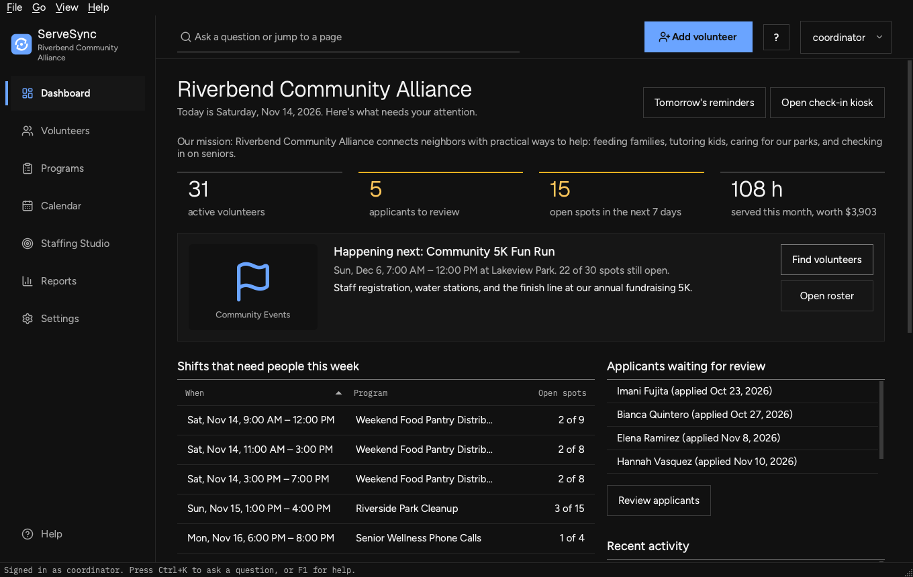
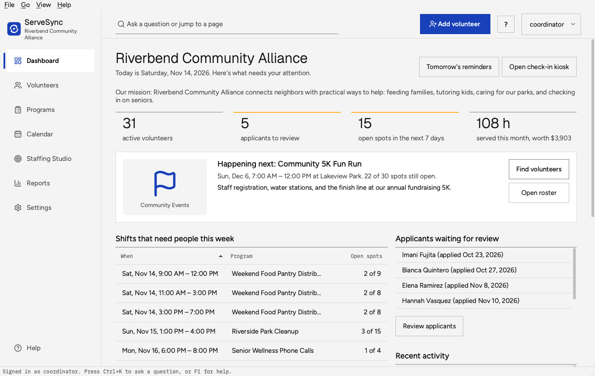
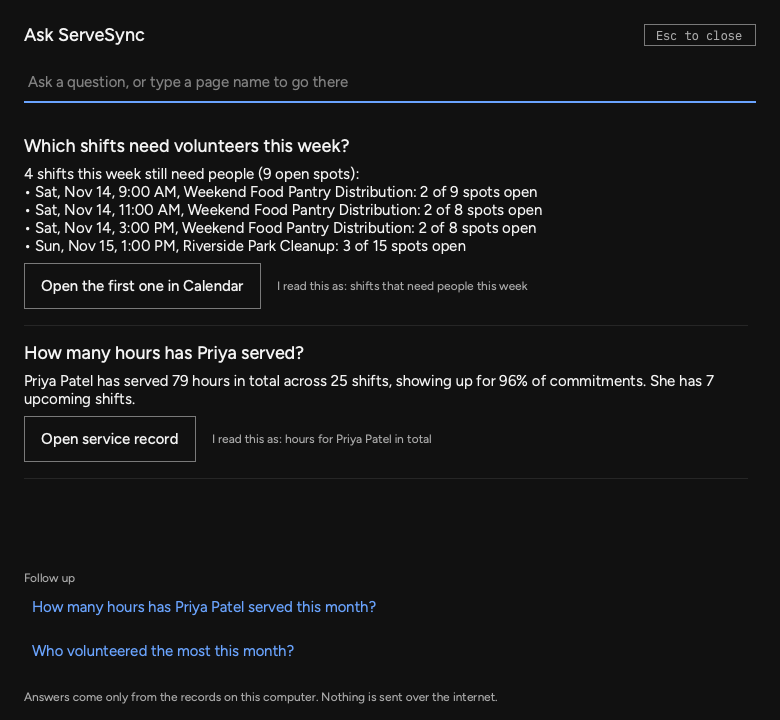
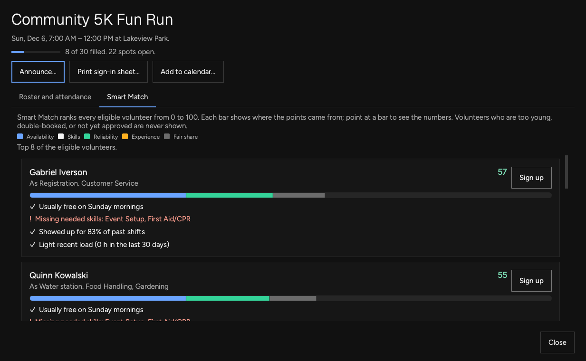
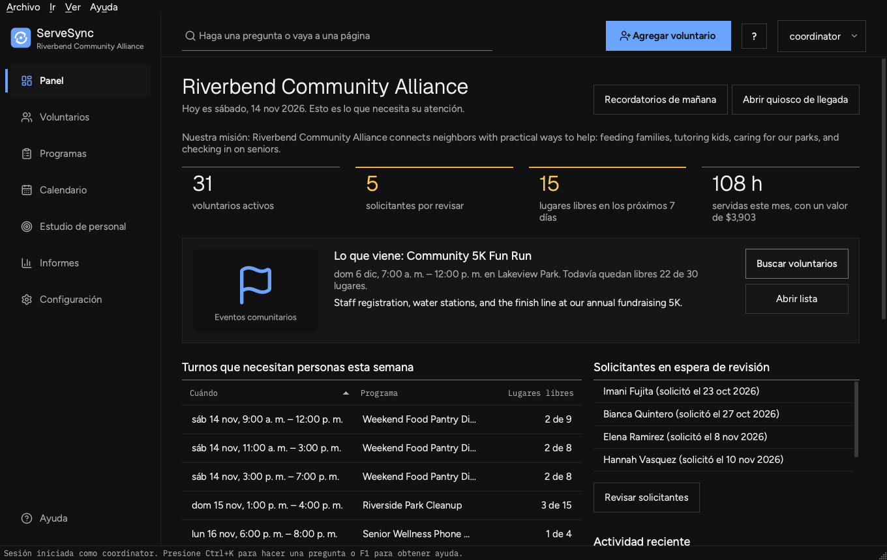

# ServeSync design rationale

ServeSync is used for long stretches: a coordinator may have it open all day at a front desk,
and a volunteer may check it on a shared library computer. The design goal is an interface that
is calm to look at for hours, makes the next action obvious, and works for people with low
vision, color blindness, tremor, dyslexia, or limited English.

Every visual decision lives in one file, `servesync/ui/theme.py`. Screens ask for a color by
*meaning* (`primary`, `text_muted`, `attention_fill`) and never by hex value; a test fails if a
page, widget or dialog hard-codes a color.

## Where the look comes from

The visual language is modelled on the sign-in page of **Hyperiux Vault** (vault.hyperiux.com),
recolored from its orange to blue. It is a dark, editorial style: a near-black canvas, large light
headings with one word picked out in the accent color, small monospaced labels, fields drawn as a
single underline, square corners and thin hairlines. It suits an app someone keeps open all day
(dark surfaces mean less glare), and the single accent makes the next action obvious.

Only the style is borrowed. Hyperiux's fonts are commercial (Aeonik Pro, Avenir Next), so ServeSync
uses open look-alikes; its logo, wording and artwork are not used. The turning globe on the sign-in
screen is our own drawing, computed in code: points spread evenly over a sphere, each joined to its
nearest neighbors, as a picture of volunteers linked to one another.

The interface was also reviewed against the
[Vercel Web Interface Guidelines](https://github.com/vercel-labs/web-interface-guidelines) where
they apply to a desktop app: visible focus on every control, the "…" character in labels that
open a window, plain loading and empty states, confirmation before anything destructive, and
inline errors next to their fields.

## Color

Black, white and gray, with one blue that always means "here" or "do this".

| Token | Dark (default) | Light | Job |
|---|---|---|---|
| Canvas | `#111111` | `#F4F4F4` | The page, sidebar and header |
| Panel | `#161616` | `#FFFFFF` | Cards and featured items, edged with a hairline |
| Hairline | `#262626` | `#DADADA` | Dividers and table rows |
| Underline | `#7A7A7A` | `#7A7A7A` | Field underlines (3:1 or better) |
| Blue | `#6AA4FF` | `#1840B8` | The main button, current page, focus, progress, the highlighted word |
| Amber | `#FFB020` | `#FFB020` | "Needs attention" markers (a shape; text uses a lighter or darker shade) |
| Green | `#34D399` | `#0E9F6E` | Success as a shape: score bars, finished goals |

**Contrast is not negotiable.** ServeSync promises 7:1 for all text (WCAG AAA). The reference's
bright accent works as a fill but not as small text, so each theme gets a blue that passes as text
too: `#6AA4FF` is 7.2:1 on the dark panels and `#1840B8` is 7.1:1 on light ones. White text on a
bright blue reaches only 4.5:1, so the dark theme's blue button carries near-black text (7.5:1),
and the light theme's deep blue button carries white (8.5:1). Secondary text is `#ABABAB` on dark
(7.6:1) and `#4A4A4A` on light (8:1). `tests/test_theme.py` checks every pair in every theme.

**High contrast** keeps its black, white and yellow with a 3 px cyan focus ring: people who
choose it need maximum contrast more than any brand look.

## Type

| Role | Font | Size (at 100%) |
|---|---|---|
| Sign-in headline, big figures | Geist Light | 3.4 x body |
| Page title | Geist Light | 2.2 x body |
| Section title | Figtree Medium | 1.2 x body |
| Body | Figtree | the person's chosen size |
| Small labels, counters, table headers, status bar | IBM Plex Mono | 0.85 x body |

**Geist** set large and light gives the calm, editorial headings; **Figtree** is a clear geometric
sans for everything people read and click; **IBM Plex Mono** marks small labels, the way the
reference does. All three are under the SIL Open Font License and bundled, so the app looks the
same on every computer.

**Atkinson Hyperlegible** (Braille Institute) is kept as a comfort setting, *Easier-to-read
letters*: it draws look-alike letters (I, l and 1; O and 0; b and d) to differ, which helps readers
with low vision. Headings are sentence case, and the whole scale grows with the person's text size
(85% to 200%).

## Layout

* **8 px rhythm on a 4 px base**, left-aligned content, generous whitespace.
* **Square corners everywhere**, flat surfaces separated by space and 1 px hairlines; no shadows
  or gradients.
* **Fields are a single underline** with the label above. On focus the underline turns blue and
  thicker; on an error it turns red and the message appears beneath, with an icon.
* **One blue button per screen.** In the main window that is the header's action (*Add volunteer*
  or *Find a shift*); other buttons are thin outlines.
* **Key figures** sit under a gray rule, set in large light numerals. A figure that needs action
  gets an amber rule and amber numerals, and screen readers hear "needs attention".
* **Sidebar:** the same black as the page; the current page is white text with a blue bar.
* **Tables:** no stripes, hairline rows 44 px tall, monospaced column labels. A long program name
  ends in "…" (its full text is in the details beside it).
* **Charts:** blue first, then white (ink on light), then green; values printed on every bar.
* **Sign-in:** the form on the left (a small "Sign in" label, "Hello *again.*", underlined fields);
  on the right the organization's name, the turning globe, the number of active volunteers and
  the mission. The globe turns only while motion is allowed.
* **Motion** only follows something the person did, apart from the slow globe; *Reduce motion*
  removes all of it.

What we avoided, and why: cream backgrounds, terracotta accents, serif display headings, sparkle
and magic-wand icons, emoji, purple-to-blue gradients, middle dots or long dashes joining labels,
arrows in button text, and marketing-style copy. They add decoration without helping anyone finish
a task.

## Two user journeys

### Volunteer: Priya, a college student who needs service hours

1. **Sign in.** The sign-in screen offers English or Español at the top, each written in its own
   language, so anyone can find theirs.
2. **Home.** Her hours, shifts completed and show-up rate are the first figures. Her hour goal
   shows a progress bar and a projected finish date, and turns green when she reaches it.
3. **Find a shift.** The header's one filled button opens *Find a shift*. Filters start with
   "Only shifts I can sign up for", so she never chooses a shift and then hits a rule. The *Fit*
   column is her Smart Match score.
4. **Sign up.** The details panel says in plain words whether she can sign up ("You can sign up
   for this shift.") or why not (too young, already booked, full). One click signs her up, and a
   short message confirms it without moving her focus.
5. **My hours.** Her service record can be saved as a PDF for school.

### Leader: Dana, the volunteer coordinator, on a Monday morning

1. **Dashboard.** Four figures; the ones that need action (applicants to review, open spots this
   week) carry an amber bar. Below them, the next event that still needs people.
2. **Review applicants.** One click opens the Volunteers page already filtered to applicants.
   *Approve* makes them active.
3. **Fill a shift.** From *Shifts that need people this week*, she opens a shift and runs Smart
   Match. Each candidate card shows a green score, a bar of where the points came from, and the
   reasons in words.
4. **Look ahead.** *Staffing Studio* drafts sign-ups for the next two weeks, forecasts turnout,
   and lists people who have quietly stopped coming. Nothing is saved until she approves.
5. **Report.** *Reports* answers a question for a period and saves exactly what is on screen as
   CSV or PDF.

## Finding your way

* **A first-run tour** for each role: a card in the corner (never a pop-up that blocks the page)
  that opens each page in turn and outlines the control it describes. It can be skipped with
  one click or Esc, is offered once, and is replayed from *Help > Take the tour*.
* **A "?" button** in the header of every page explains that page in a few lines.
* **Help > How ServeSync addresses the topic** maps each phrase of the FBLA prompt to the screens
  that do it, for judges and for new staff.

## Accessibility features

| Need | What ServeSync does | WCAG |
|---|---|---|
| Low vision | 7:1 text contrast in every theme; High contrast theme; text 85% to 200% (Ctrl+= and Ctrl+-) with nothing clipped | 1.4.6, 1.4.4 |
| Finding controls | Input borders and focus rings at 3:1 or better; a 2 to 3 px focus outline on everything | 1.4.11, 2.4.13 |
| Motor and tremor | Every target at least 44 x 44 px, growing with text size | 2.5.5 |
| Keyboard only | Every action works without a mouse; charts respond to arrow keys; Ctrl+K reaches any page or answer | 2.1.3 |
| Screen readers | Accessible names on every control; changes announced without moving focus; charts have text summaries | 4.1.3, 1.1.1 |
| Motion sensitivity | Motion only follows the person's action; *Reduce motion* removes it | 2.3.3 |
| Dyslexia | Atkinson Hyperlegible; optional extra letter and word spacing; no all-caps text | 1.4.12, 1.4.8 |
| Attention and memory | *Simplified layout* hides secondary sections; one filled button per screen; plain-language messages | 3.1.5 |
| Color vision | Status always has words or a shape; errors have an icon; chart values are printed | 1.4.1 |
| Language | Every screen, message, report and help page in English and Spanish | 3.1.2 |

## Screens

| Dark (default) | Light | High contrast, 150% text |
|---|---|---|
|  |  |  |

| Ask ServeSync | Smart Match | Spanish |
|---|---|---|
|  |  |  |
