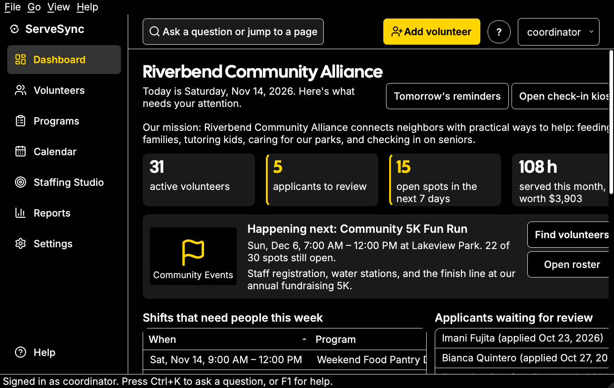

# ServeSync design rationale

ServeSync is used for long stretches: a coordinator may have it open all day at a front desk,
and a volunteer may check it on a shared library computer. The design goal is an interface that
is calm to look at for hours, makes the next action obvious, and works for people with low
vision, color blindness, tremor, dyslexia, or limited English.

Every visual decision lives in one file, `servesync/ui/theme.py`. Screens ask for a color by
*meaning* (`primary`, `text_muted`, `attention_fill`) and never by hex value; a test fails if a
page, widget or dialog hard-codes a color.

## Where the look comes from

The visual system follows **Cal.com's**, as documented in its DESIGN.md in VoltAgent's
[awesome-design-md](https://github.com/VoltAgent/awesome-design-md) collection. Cal.com is
scheduling software, so its language (calendars, time slots, people, one clear action) already
fits shifts and volunteers, and its near-monochrome calm suits a screen someone looks at all day.
Only the system is borrowed: the type roles, spacing, surfaces, corners and component shapes.
No Cal.com logo, wording or artwork is used, and the ServeSync mark is our own.

The interface was also reviewed against the
[Vercel Web Interface Guidelines](https://github.com/vercel-labs/web-interface-guidelines) where
they apply to a desktop app: visible focus on every control, the "…" character in labels that
open a window, plain loading and empty states, confirmation before anything destructive, and
inline errors next to their fields.

## Color

Near-monochrome, with color reserved for meaning.

| Token | Value | Job |
|---|---|---|
| Ink | `#111111` | Headings, primary text, and the black primary button |
| Canvas | `#FFFFFF` | The page |
| Card | `#F5F5F5` | Cards and key figures (light gray, no border) |
| Hairline | `#E5E7EB` | Dividers and table rows |
| Blue | `#3B82F6` | The one accent: keyboard focus, the active chart series |
| Amber | `#F59E0B` | "Needs attention" markers and calendar dots (a shape, never text) |
| Green | `#10B981` | Success as a shape: score bars, finished goals |

**Contrast is not negotiable.** ServeSync promises 7:1 for all text (WCAG AAA), and several of
Cal.com's colors fall short as text: its gray `#6B7280` is 4.8:1 on white, its blue 3.7:1, its
green 2.5:1, its red 3.8:1. So text uses deeper shades of the same hues (secondary text
`#374151`, links `#1E40AF`, success `#065F46`, errors `#991B1B`), and the original bright
colors are kept for fills, dots and chart bars, where 3:1 is the standard. Input borders use
`#757B84` (4.3:1) so every field can be found, while secondary buttons keep Cal.com's softer edge
because their label identifies them. `tests/test_theme.py` checks every pair, in every theme,
including text on gray cards.

**Dark theme:** Cal.com's own dark surfaces (`#101010`, `#1A1A1A`), white primary buttons with
black text, and lighter tints of the same blue, green, amber and red.

**High contrast** keeps its black, white and yellow with a 3 px cyan focus ring: people who
choose it need maximum contrast more than any brand look.

## Type

| Role | Font | Size (at 100%) |
|---|---|---|
| Page title, key figures | Cal Sans | 1.75 x body |
| Section title | Inter SemiBold | 1.15 x body |
| Body | Inter | the person's chosen size |
| Caption | Inter | 0.88 x body |

**Cal Sans** is Cal.com's open-source geometric display face, tight and confident; it is drawn
heavy at its regular weight, so it is never bolded further. **Inter** handles everything people
read and click: it was designed for screens and has clear figures. Both are under the SIL Open
Font License and bundled, so the app looks the same on every computer.

**Atkinson Hyperlegible** (Braille Institute) is kept as a comfort setting, *Easier-to-read
letters*: it draws look-alike letters (I, l and 1; O and 0; b and d) to differ, which helps readers
with low vision. Headings are sentence case, with no all-caps labels, and the whole scale grows
with the person's text size (85% to 200%).

## Layout

* **8 px rhythm on a 4 px base**, left-aligned content, generous but not empty whitespace.
* **Light-gray cards without borders** for separate objects (a shift, a recommendation, the
  featured event) and for the key figures; everything else is a plain section with a heading.
  A figure that needs action gets an amber bar, and screen readers hear "needs attention".
* **Corners:** 8 px on buttons and inputs, 12 px on cards, tables and dialogs.
* **One black primary button per screen.** In the main window that is the header's action (*Add
  volunteer* or *Find a shift*); other buttons are white with a soft gray edge.
* **Sidebar:** soft gray, the current page a filled gray row in bold ink with its icon.
* **Segmented choices** (language, theme) are a gray group with the chosen option raised in white.
* **Tables:** no stripes, hairline rows 44 px tall, a light gray hover. A long program name ends in
  "…" (its full text is in the details beside it); only when even a short column won't fit, at large
  text sizes, does the table scroll sideways.
* **Charts:** ink first, then blue, then green, on neutral gridlines; the bar or point being
  inspected turns blue. Values are printed on every bar.
* **Ask ServeSync** looks like a search panel, not a chat: each question and its answer form one
  plain row.
* **Motion** only follows something the person did; *Reduce motion* removes it.

What we avoided, and why: cream backgrounds, terracotta accents, serif display headings, sparkle
and magic-wand icons, emoji, purple-to-blue gradients, small labels above headings, middle dots or
long dashes joining labels, arrows in button text, and marketing-style copy. They are common in
generated interfaces and add decoration without helping anyone finish a task.

## Two user journeys

### Volunteer: Priya, a college student who needs service hours

1. **Sign in.** The sign-in screen offers English or Español at the top, each written in its own
   language, so anyone can find theirs.
2. **Home.** Her hours, shifts completed and show-up rate are the first figures. Her hour goal
   shows a progress bar and a projected finish date, and turns green when she reaches it.
3. **Find a shift.** The header's one filled button opens *Find a shift*. Filters start with
   "Only shifts I can sign up for", so she never chooses a shift and then hits a rule. The *Fit*
   column is her Smart Match score.
4. **Sign up.** The details panel says in plain words whether she can sign up ("You can sign up
   for this shift.") or why not (too young, already booked, full). One click signs her up, and a
   short message confirms it without moving her focus.
5. **My hours.** Her service record can be saved as a PDF for school.

### Leader: Dana, the volunteer coordinator, on a Monday morning

1. **Dashboard.** Four figures; the ones that need action (applicants to review, open spots this
   week) carry an amber bar. Below them, the next event that still needs people.
2. **Review applicants.** One click opens the Volunteers page already filtered to applicants.
   *Approve* makes them active.
3. **Fill a shift.** From *Shifts that need people this week*, she opens a shift and runs Smart
   Match. Each candidate card shows a green score, a bar of where the points came from, and the
   reasons in words.
4. **Look ahead.** *Staffing Studio* drafts sign-ups for the next two weeks, forecasts turnout,
   and lists people who have quietly stopped coming. Nothing is saved until she approves.
5. **Report.** *Reports* answers a question for a period and saves exactly what is on screen as
   CSV or PDF.

## Finding your way

* **A first-run tour** for each role: a card in the corner (never a pop-up that blocks the page)
  that opens each page in turn and outlines the control it describes. It can be skipped with
  one click or Esc, is offered once, and is replayed from *Help > Take the tour*.
* **A "?" button** in the header of every page explains that page in a few lines.
* **Help > How ServeSync addresses the topic** maps each phrase of the FBLA prompt to the screens
  that do it, for judges and for new staff.

## Accessibility features

| Need | What ServeSync does | WCAG |
|---|---|---|
| Low vision | 7:1 text contrast in every theme; High contrast theme; text 85% to 200% (Ctrl+= and Ctrl+-) with nothing clipped | 1.4.6, 1.4.4 |
| Finding controls | Input borders and focus rings at 3:1 or better; a 2 to 3 px focus outline on everything | 1.4.11, 2.4.13 |
| Motor and tremor | Every target at least 44 x 44 px, growing with text size | 2.5.5 |
| Keyboard only | Every action works without a mouse; charts respond to arrow keys; Ctrl+K reaches any page or answer | 2.1.3 |
| Screen readers | Accessible names on every control; changes announced without moving focus; charts have text summaries | 4.1.3, 1.1.1 |
| Motion sensitivity | Motion only follows the person's action; *Reduce motion* removes it | 2.3.3 |
| Dyslexia | Atkinson Hyperlegible; optional extra letter and word spacing; no all-caps text | 1.4.12, 1.4.8 |
| Attention and memory | *Simplified layout* hides secondary sections; one filled button per screen; plain-language messages | 3.1.5 |
| Color vision | Status always has words or a shape; errors have an icon; chart values are printed | 1.4.1 |
| Language | Every screen, message, report and help page in English and Spanish | 3.1.2 |

## Screens

| Light | Dark | High contrast, 150% text |
|---|---|---|
|  |  |  |

| Ask ServeSync | Smart Match | Spanish |
|---|---|---|
|  |  |  |
