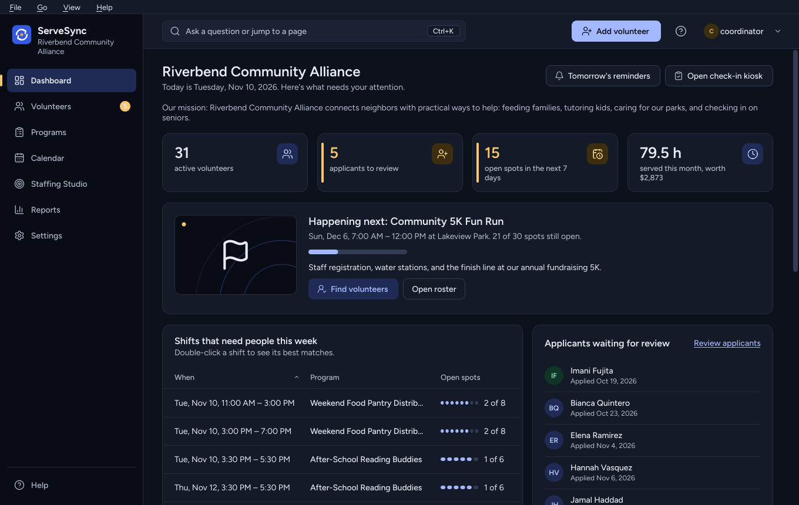

# ServeSync design rationale

ServeSync is used for long stretches: a coordinator may have it open all day at a front desk,
and a volunteer may check it on a shared library computer. The design goal is an interface that
is calm to look at for hours, makes the next action obvious, and works for people with low
vision, color blindness, tremor, dyslexia, or limited English.

Every visual decision lives in one file, `servesync/ui/theme.py`. Screens ask for a color by
*meaning* (`primary`, `text_muted`, `attention_fill`) and never by hex value; a test fails if a
page, widget or dialog hard-codes a color.

## Color

Three colors, plus cool neutrals. Each color has one job, so its meaning stays clear.

| Color | Value | Job | Where it appears |
|---|---|---|---|
| Cobalt | `#1D43C6` | The working color | The one filled button per screen, links, selected rows, keyboard focus; as deep navy (`#101C3F`), the sidebar that frames the app |
| Warm amber | `#F4A62A` | Look here | "Needs attention" bars on key figures, the sidebar count of applicants waiting, calendar dots for days with open spots, the current page's marker |
| Emerald | `#0E9F6E` | Good news | Open spots, the Smart Match score ring, attended shifts, finished goals |

**Why these three.** Cobalt reads as trustworthy and capable, and holds 7.9:1 on white, so it can
be both a button fill and link text. Amber is cobalt's complement on the color wheel, so a single
amber mark stands out on an otherwise cool screen without needing to be large. Emerald is the
conventional "done" color; keeping it rare means a green tag is worth reading.

**Rules that keep it calm.**

* Amber and emerald are too light to be text on white. They appear as shapes (a bar, a dot, a
  ring, a meter); text that belongs to them uses a deeper shade of the same hue (`#6E4205` amber
  text, `#055C3C` emerald text), which keeps the 7:1 contrast the app meets everywhere.
* Statuses are worded tags on a soft tint of their hue: *Active* (emerald), *Applicant* (amber),
  *Scheduled* (cobalt), *No-show* (red), *Inactive* (gray). The tint helps scanning; the word
  carries the meaning, so nothing depends on color alone.
* Errors stay red (`#9B1C13`) and always come with a warning icon and words.

**Neutrals.** A cool canvas (`#F4F6FA`), white cards with hairline borders (`#E4E8F0`), ink text
(`#111A2E`) and slate secondary text (`#4A5264`, 7.1:1). Input borders are darker (`#828C9F`,
3.1:1) so every field is easy to find.

**Dark theme.** Canvas `#0D111C`, cards `#151A28`, and lighter tints of the same three hues
(cobalt `#A3B8FF`, amber `#F7C66E`, emerald `#63DCAB`), so meaning carries over and every text
color still reaches 7:1.

**High contrast theme.** Black, white and yellow with a 3 px cyan focus ring. People who choose
it need maximum contrast more than they need brand colors, so it keeps its own palette.

`tests/test_theme.py` computes every contrast ratio with the WCAG formula, for every theme:
text 7:1 on every background it can sit on (including each status tag), borders and focus rings
3:1, and button labels 7:1.

## Type

One typeface, **Figtree** (SIL Open Font License), in four weights. It is clean and friendly,
with open letter shapes and even spacing that stay comfortable over a long shift, and tabular
figures so columns of hours and dates line up.

| Role | Weight | Size at 100% |
|---|---|---|
| Sign-in and kiosk headline | SemiBold | 28 px |
| Page title | SemiBold | 24 px |
| Key figure | SemiBold | 26 px |
| Section and card title | SemiBold | 16 px |
| Body | Regular | 14 px |
| Labels, secondary text | Medium / Regular | 13 px |
| Hints, table headers, tags | Regular / SemiBold | 12 px |

Sizes are set in pixels, so the app looks the same on macOS and Windows (which count points
differently). **Atkinson Hyperlegible** (Braille Institute) is one switch away in Settings as the
*Easy-read font*: it makes easily confused characters (I, l and 1; O and 0) look different, which
helps readers with low vision.

Headings are sentence case. There are no all-caps or letter-spaced labels, because all caps are
slower to read, especially for people with dyslexia. The whole scale grows with the person's text
size (85% to 200%), so nothing clips.

## Layout

* **Three layers.** A cool canvas, white cards with hairline borders and 12 px corners, and the
  navy sidebar. Only things that float (messages, the tour card) cast a shadow.
* **8 px grid.** Margins, gaps and padding are multiples of 8 (with a 4 px half step). Content is
  left-aligned so the eye always returns to the same edge.
* **Key figures** sit in a row of tiles, each with an icon. A figure that needs action gets an
  amber bar and an amber icon, and screen readers hear "needs attention".
* **People look like people.** Every roster, applicant list and activity feed leads with initials
  in a tinted circle, so a list reads as a team rather than rows of text.
* **Capacity at a glance.** Shifts show a spot meter (one segment per spot) that turns emerald
  when the shift is full.
* **Controls.** Buttons and fields are drawn 36 px tall with 8 px corners, inside a 44 px target
  (the rest is an invisible margin), so they look tidy but are easy to hit (WCAG 2.5.5 AAA).
* **One filled button per screen.** In the main window, the header's action (*Add volunteer* for
  leaders, *Find a shift* for volunteers) is the only filled button. A section's own action is a
  soft blue tonal button; everything else is quiet white. A dialog's main action (Save, Sign in)
  is filled.
* **Sidebar.** Deep navy, with the current page on a lighter navy and an amber marker beside it.
  The Volunteers item carries an amber count while applicants are waiting.
* **Forms** put each label above its field: one straight edge to scan, room for long Spanish
  labels, and errors in words directly under the field.
* **Tables.** No zebra stripes or grid; hairline dividers, rows of 48 px or more, a soft tint
  under the pointer and on the selected row. When text is large, the table scrolls sideways rather
  than squeezing a column until its text is cut off.
* **Charts.** Cobalt first, then amber, then emerald, on neutral gridlines. Values are printed on
  every bar, and each chart has a text summary and a matching table.
* **Ask ServeSync** looks like a search panel: a search box, then plain rows that pair each
  question with its answer. It deliberately avoids chat bubbles, because it looks up the
  organization's own records and should not suggest a person or general chatbot is replying.
* **Motion** only follows something the person did: a page fades in, the sidebar marker slides
  to the new page. *Reduce motion* removes all of it.

What we avoided, and why: cream backgrounds, terracotta accents, serif display headings, sparkle
and magic-wand icons, emoji, purple-to-blue gradients, small labels above headings, pill chips,
middle dots or long dashes joining labels, arrows in button text, and marketing-style copy. They
are common in generated interfaces, and they add decoration without helping anyone finish a task.

## Two user journeys

### Volunteer: Priya, a college student who needs service hours

1. **Sign in.** The sign-in screen offers English or Español at the top, each written in its own
   language, so anyone can find theirs.
2. **Home.** Her hours, shifts completed and show-up rate are the first figures. Her hour goal
   shows a progress bar that turns emerald when she reaches it.
3. **Find a shift.** The header's one filled button opens *Find a shift*. Filters start with
   "Only shifts I can sign up for", so she never chooses a shift and then hits a rule. The *Fit*
   column is her Smart Match score.
4. **Sign up.** The details panel says in plain words whether she can sign up ("You can sign up
   for this shift.") or why not (too young, already booked, full). One click signs her up, and a
   short message confirms it without moving her focus.
5. **My hours.** Her service record can be saved as a PDF for school.

### Leader: Dana, the volunteer coordinator, on a Monday morning

1. **Dashboard.** Four figures; the ones that need action (applicants to review, open spots this
   week) carry an amber bar. Below them, the next event that still needs people.
2. **Review applicants.** One click opens the Volunteers page already filtered to applicants.
   *Approve* makes them active.
3. **Fill a shift.** From *Shifts that need people this week*, she opens a shift and runs Smart
   Match. Each candidate card shows an emerald score, a bar of where the points came from, and the
   reasons in words.
4. **Look ahead.** *Staffing Studio* drafts sign-ups for the next two weeks, forecasts turnout,
   and lists people who have quietly stopped coming. Nothing is saved until she approves.
5. **Report.** *Reports* answers a question for a period and saves exactly what is on screen as
   CSV or PDF.

## Finding your way

* **A first-run tour** for each role: a card in the corner (never a pop-up that blocks the page)
  that opens each page in turn and outlines the control it describes. It can be skipped with
  one click or Esc, is offered once, and is replayed from *Help > Take the tour*.
* **A "?" button** in the header of every page explains that page in a few lines.
* **Help > How ServeSync addresses the topic** maps each phrase of the FBLA prompt to the screens
  that do it, for judges and for new staff.

## Accessibility features

| Need | What ServeSync does | WCAG |
|---|---|---|
| Low vision | 7:1 text contrast in every theme; High contrast theme; text 85% to 200% (Ctrl+= and Ctrl+-) with nothing clipped | 1.4.6, 1.4.4 |
| Finding controls | Input borders and focus rings at 3:1 or better; a 2 to 3 px focus outline on everything | 1.4.11, 2.4.13 |
| Motor and tremor | Every target at least 44 x 44 px, growing with text size | 2.5.5 |
| Keyboard only | Every action works without a mouse; charts respond to arrow keys; Ctrl+K reaches any page or answer | 2.1.3 |
| Screen readers | Accessible names on every control; changes announced without moving focus; charts have text summaries | 4.1.3, 1.1.1 |
| Motion sensitivity | Motion only follows the person's action; *Reduce motion* removes it | 2.3.3 |
| Dyslexia | Atkinson Hyperlegible; optional extra letter and word spacing; no all-caps text | 1.4.12, 1.4.8 |
| Attention and memory | *Simplified layout* hides secondary sections; one filled button per screen; plain-language messages | 3.1.5 |
| Color vision | Status always has words or a shape; errors have an icon; chart values are printed | 1.4.1 |
| Language | Every screen, message, report and help page in English and Spanish | 3.1.2 |

## Screens

| Light | Dark | High contrast, 150% text |
|---|---|---|
|  |  |  |

| Ask ServeSync | Smart Match | Spanish |
|---|---|---|
|  |  |  |
